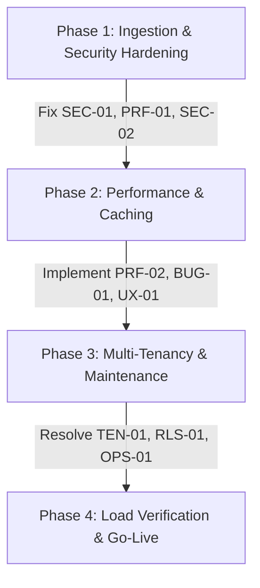

# Industrial Intelligence Engine: Production Readiness Audit & Remediation Plan

**Document Version:** 1.0.0  
**Classification:** Engineering Roadmap & Production Remediation  
**Target Systems:** Edge Tracker (`aura.js`, `banner.js`), Backend API (FastAPI, SQLModel, Alembic, PostgreSQL), Integration Pipelines (IPinfo, Apollo.io, DeepSeek, Slack, iKhokha)

---

## 1. Executive Summary

This document presents a comprehensive audit of the **Industrial Intelligence Engine** codebase and provides an actionable, phase-by-phase implementation plan to remediate architectural bottlenecks, security gaps, tenant isolation defects, and scalability limits before deploying to real-world commercial clients.

Each issue is analyzed with its **Root Cause**, **Real-World Blast Radius**, **Precise Code Location**, and a complete **Step-by-Step Implementation Plan** including production-ready code replacements.

---

## 2. Master Remediation Matrix

| ID | Component | Severity | Description | Target Files |
| :--- | :--- | :--- | :--- | :--- |
| **SEC-01** | API / Routing | 🔴 **Critical** | Static CORS whitelist blocks third-party client websites from sending telemetry | `backend/app/main.py`, `backend/app/core/config.py` |
| **PRF-01** | Backend Core | 🔴 **Critical** | Synchronous `socket.gethostbyaddr` blocks the asyncio event loop under load | `backend/app/services/enrichment.py` |
| **PRF-02** | Enrichment | 🟠 **High** | Ingestion pipeline lacks caching, causing IPinfo quota exhaustion | `backend/app/services/enrichment.py` |
| **SEC-02** | Security / POPIA | 🟠 **High** | Volunteered phone numbers stored in plaintext on primary ingestion path | `backend/app/api/v1/track.py` |
| **BUG-01** | Lead Analytics | 🟠 **High** | `AttributeError: 'Visit' object has no attribute 'url'` crashes intelligence route | `backend/app/api/v1/leads.py` |
| **TEN-01** | Notifications | 🟠 **High** | Slack/CRM/Notion destinations are global, leaking all tenant leads to system admin | `backend/app/models/client.py`, `backend/app/services/notifications.py` |
| **RLS-01** | Database / Tasks | 🟡 **Medium** | RLS blocks background Janitor and Scheduler sweeps from finding records | `backend/app/tasks/janitor.py`, `backend/app/core/scheduler.py` |
| **UX-01** | Edge Tracker | 🟡 **Medium** | Asset gate (`.pdf`, `.cad`) causes permanent download locks if banner fails | `tracker/src/public/aura.js` |
| **PRF-03** | AI Intelligence | 🟡 **Medium** | Synchronous 15s DeepSeek LLM timeout on exit beacons risks worker saturation | `backend/app/services/intelligence.py`, `backend/app/api/v1/track.py` |
| **OPS-01** | Infrastructure | 🟡 **Medium** | Single-worker Uvicorn startup model limits concurrent throughput | `backend/start.sh` |

---

## 3. Detailed Issue Analysis & Implementation Plans

---

### [SEC-01] Dynamic CORS & Ingestion Gate for Third-Party Websites

#### Problem Description & Root Cause
In `backend/app/main.py` (lines 193–201) and `backend/app/core/config.py` (lines 74–89), FastAPI's `CORSMiddleware` is configured with a static list of allowed origins (`ALLOWED_ORIGINS` and `ALLOWED_ORIGIN_REGEX`). 

When a paying client embeds `aura.js` on their external domain (e.g. `https://client-corp.co.za`), the browser sends a cross-origin `POST` request with `Content-Type: application/json`. Modern browsers enforce a CORS `OPTIONS` preflight. Because `client-corp.co.za` is not in the hardcoded origin list, the browser receives an unauthorized CORS preflight response and blocks all tracking requests (`/v1/track/entry`, `/v1/track/identity`, `/v1/track/exit`).

#### Real-World Impact
**Total failure of third-party tracking.** The tracker cannot record a single visit or lead from any external customer site in production.

#### Implementation Plan

1. **Implement Ingestion Route CORS Bypass:** Telemetry ingestion endpoints (`/v1/track/*` and `/api/v1/track/*`) do not utilize authentication cookies or credential headers. They receive public telemetry. A dedicated middleware should handle these routes by responding with `Access-Control-Allow-Origin: *` or dynamically validating against `client.whitelisted_domains`.
2. **Update `backend/app/main.py`:** Add dynamic origin resolution in the CORS middleware stack.

```python
# backend/app/main.py

from fastapi.middleware.cors import CORSMiddleware
from starlette.middleware.base import BaseHTTPMiddleware
from starlette.requests import Request
from starlette.responses import Response

class IngestionCORSMiddleware(BaseHTTPMiddleware):
    """
    Permits cross-origin telemetry posts from any whitelisted client website
    without exposing administrative session cookies.
    """
    async def dispatch(self, request: Request, call_next):
        # Handle preflight for tracking endpoints
        if request.url.path.startswith(("/v1/track", "/api/v1/track", "/v1/clients/config", "/api/v1/clients/config")):
            if request.method == "OPTIONS":
                response = Response(status_code=204)
                origin = request.headers.get("origin", "*")
                response.headers["Access-Control-Allow-Origin"] = origin
                response.headers["Access-Control-Allow-Methods"] = "POST, GET, OPTIONS"
                response.headers["Access-Control-Allow-Headers"] = "Content-Type, X-Client-ID, Authorization"
                response.headers["Access-Control-Max-Age"] = "86400"
                return response
            
            response = await call_next(request)
            origin = request.headers.get("origin")
            if origin:
                response.headers["Access-Control-Allow-Origin"] = origin
            return response
            
        return await call_next(request)

# Register before standard CORSMiddleware
app.add_middleware(IngestionCORSMiddleware)
```

---

### [PRF-01] Non-Blocking Reverse DNS Resolution

#### Problem Description & Root Cause
In `backend/app/services/enrichment.py` (lines 30–50), `perform_local_reverse_dns` calls Python's standard `socket.gethostbyaddr(ip_address)`. This is a synchronous, blocking network call executed on the main asyncio worker thread during `process_entry_logic`.

#### Real-World Impact
If an IP address lacks a reverse DNS (PTR) record or the upstream DNS nameserver takes 2–5 seconds to respond, **the entire FastAPI worker process stops processing all requests** for that duration. Under real-world South African network conditions (high latency, frequent missing PTRs for LTE/fiber subnets), concurrent site traffic will completely stall the API.

#### Implementation Plan

1. Replace the blocking `socket.gethostbyaddr` call with an asynchronous executor (`asyncio.to_thread`) wrapped in a strict 800ms timeout.
2. If DNS times out, fall back immediately to `"unknown"` without delaying the pipeline.

```python
# backend/app/services/enrichment.py
import asyncio
import socket

async def perform_local_reverse_dns_async(ip_address: str) -> Dict[str, Any]:
    """
    Layer 1: Non-blocking Zero-Cost Classification.
    Resolves hostname in a thread pool with a strict 800ms timeout.
    """
    def _resolve(ip: str):
        try:
            hostname, _, _ = socket.gethostbyaddr(ip)
            return hostname.lower()
        except Exception:
            return None

    try:
        hostname = await asyncio.wait_for(asyncio.to_thread(_resolve, ip_address), timeout=0.8)
        if not hostname:
            return {"type": "unknown", "provider": "Unknown", "confidence": 0.0}

        # Cloud/Data Center filtration
        if any(cloud in hostname for cloud in ["amazonaws", "googleusercontent", "azure", "hetzner"]):
            return {"type": "cloud", "provider": "Infrastructure", "confidence": 0.5}
        
        # Consumer ISP filtration
        if is_consumer_traffic(hostname):
            return {"type": "isp", "provider": "Consumer ISP", "confidence": 0.2}
        
        return {"type": "business_static", "provider": hostname, "confidence": 0.7}
    except asyncio.TimeoutError:
        logger.debug(f"Reverse DNS resolution timed out for IP: {ip_address}")
        return {"type": "unknown", "provider": "Unknown (DNS Timeout)", "confidence": 0.0}
    except Exception:
        return {"type": "unknown", "provider": "Unknown", "confidence": 0.0}
```

---

### [PRF-02] Shared Two-Tier Ingestion Cache for IP Intelligence

#### Problem Description & Root Cause
In `backend/app/api/v1/track.py:14`, the entry point imports `enrich_visitor_data` from `app.services.enrichment`. However, `enrichment.py` contains no cache lookup. Every visitor hit makes a fresh HTTP request to `https://ipinfo.io/{ip}?token=...`. While `intelligence.py` had an isolated `ip_cache`, it is completely bypassed.

#### Real-World Impact
* **Rapid API quota depletion:** A client site with 10,000 pageviews/day will make 10,000 requests to IPinfo, exceeding free or lower-tier quotas within days.
* **Unnecessary latency:** Every incoming `/v1/track/entry` waits 200–500ms on external HTTP queries to IPinfo.

#### Implementation Plan

1. Integrate `TwoTierCache` (`backend/app/core/cache.py`) directly into `enrich_visitor_data` in `backend/app/services/enrichment.py`.
2. Cache successful IP lookups with a 24-hour TTL (`86400` seconds).

```python
# backend/app/services/enrichment.py
import json
from app.core.cache import TwoTierCache

async def enrich_visitor_data(ip_address: str, volunteered_company: Optional[str] = None) -> dict:
    if ip_address in ("127.0.0.1", "localhost", "::1"):
        return {"company_name": "Local Test Environment", "is_b2b": False, "confidence_score": 1.0}

    if volunteered_company and not is_consumer_traffic(volunteered_company):
        return {
            "company_name": volunteered_company,
            "domain": None,
            "is_b2b": True,
            "confidence_score": 1.0,
            "industry": "Volunteered Data",
            "provider_type": "Warm Lead"
        }

    # 1. Check Two-Tier Cache (Redis -> Memory)
    cache_key = f"ip_intel:{ip_address}"
    try:
        cached = await TwoTierCache.get(cache_key)
        if cached:
            return json.loads(cached)
    except Exception as e:
        logger.warning(f"Cache lookup failed for {ip_address}: {e}")

    # 2. Local Async Reverse DNS
    local_intel = await perform_local_reverse_dns_async(ip_address)

    # 3. IPinfo Query
    if not settings.IPINFO_TOKEN:
        return {"company_name": local_intel["provider"], "is_b2b": False, "confidence_score": 0.3}

    url = f"https://ipinfo.io/{ip_address}?token={settings.IPINFO_TOKEN}"
    async with httpx.AsyncClient() as client:
        # [Existing IPinfo query and payload compilation...]
        result_data = { ... }
        
        # 4. Store in Cache (24-hour TTL)
        try:
            await TwoTierCache.set(cache_key, json.dumps(result_data), expire=86400)
        except Exception as e:
            logger.warning(f"Cache write failed for {ip_address}: {e}")

        return result_data
```

---

### [SEC-02] Mandatory PII Encryption in Edge Ingestion

#### Problem Description & Root Cause
In `backend/app/api/v1/track.py:328`:
```python
if payload.phone: lead.phone_encrypted = payload.phone
```
When visitors submit contact details via the consent banner or asset gate, the raw phone number is assigned directly to `lead.phone_encrypted` without encryption. In contrast, `backend/app/api/v1/prospects.py:270` calls `encrypt_field(payload.get("phone"))`.

#### Real-World Impact
Direct violation of South Africa's Protection of Personal Information Act (POPIA) Section 19 security safeguard mandates. PII is stored in plaintext in PostgreSQL despite marketing claims of "AES-256 encrypted at rest."

#### Implementation Plan

1. Import `encrypt_field` in `backend/app/api/v1/track.py`.
2. Encrypt all phone inputs before committing to the database.

```python
# backend/app/api/v1/track.py
from app.core.security import encrypt_field

# Inside track_identity():
if payload.phone:
    lead.phone_encrypted = encrypt_field(payload.phone)
```

---

### [BUG-01] Fix Attribute Error in Lead Intelligence Route

#### Problem Description & Root Cause
In `backend/app/api/v1/leads.py` (lines 140–143):
```python
"forensic_trail": [
    {"timestamp": v.created_at, "url": v.url, "duration": v.duration} 
    for v in visits
]
```
The `Visit` model does not have a `url` attribute (URLs are recorded on the `PageView` table). Accessing `v.url` raises `AttributeError: 'Visit' object has no attribute 'url'` and returns HTTP 500 when viewing lead journeys in the dashboard.

#### Real-World Impact
Administrative users and sales teams cannot view detailed forensic trails or lead intelligence profiles.

#### Implementation Plan

Update `backend/app/api/v1/leads.py` to join and pull from `PageView`:

```python
# backend/app/api/v1/leads.py

# 3. Pull PageView History for Activity Heatmap
pv_stmt = (
    select(PageView)
    .join(Visit, PageView.visit_id == Visit.id)
    .where(Visit.aura_id == aura_id)
    .order_by(PageView.created_at.desc())
)
res_pv = await session.execute(pv_stmt)
page_views = res_pv.scalars().all()

return {
    "lead_profile": {
        "name": lead.name,
        "position": lead.position,
        "department": lead.department,
        "email": lead.email
    },
    "company_intel": company,
    "forensic_trail": [
        {"timestamp": pv.created_at, "url": pv.url_path, "duration": pv.duration} 
        for pv in page_views
    ],
    "total_engagement_points": len(page_views)
}
```

---

### [TEN-01] Per-Tenant Webhook Routing

#### Problem Description & Root Cause
In `backend/app/services/notifications.py`, all notification functions (`post_to_slack`, `handle_juristic_only_alert`, `post_surge_alert_to_slack`) read destinations exclusively from `settings.SLACK_WEBHOOK_URL`. Similarly, `backend/app/services/vault.py` sends leads to a single global Airtable base and Notion database.

#### Real-World Impact
In a multi-tenant SaaS deployment, **every lead from Client A is broadcast to Client B or dumped into the operator's internal Slack**. Clients cannot configure their own Slack channels or CRM webhooks.

#### Implementation Plan

1. **Extend `ClientBase` in `backend/app/models/client.py`:**
   Add `slack_webhook_url`, `crm_webhook_url`, `airtable_base_id`, and `airtable_api_key`.
2. **Update `backend/app/services/notifications.py`:**
   Query the client's configured webhook first before falling back to system defaults.

```python
# backend/app/models/client.py
class ClientBase(SQLModel):
    # Existing fields...
    slack_webhook_url: Optional[str] = Field(default=None, nullable=True)
    crm_webhook_url: Optional[str] = Field(default=None, nullable=True)
```

```python
# backend/app/services/notifications.py
async def post_to_slack(prospect_data: dict, journey: dict = None, client_id: Optional[UUID] = None):
    webhook_url = None
    if client_id and async_session_maker:
        async with async_session_maker() as session:
            client = await session.get(Client, client_id)
            if client and client.slack_webhook_url:
                webhook_url = client.slack_webhook_url

    if not webhook_url:
        webhook_url = settings.SLACK_WEBHOOK_URL

    if not webhook_url:
        return

    # [Dispatch logic...]
```

---

### [RLS-01] Background Task RLS Bypass Policy

#### Problem Description & Root Cause
In `backend/async_migrations/versions/90cdb20cc080_phase_19_hard_reset.py`, PostgreSQL Row-Level Security (RLS) is forced on `visit`, `company`, `prospect`, and `page_view` using:
```sql
USING (client_id = nullif(current_setting('app.current_client_id', true), '')::uuid)
```
Background tasks (`cleanup_unverified_visits` in `janitor.py`, `run_enrichment_cycle` in `scheduler.py`) execute maintenance loops across all tenants without setting `app.current_client_id`. Unless running under a database superuser role, `client_id = NULL` evaluates to `False` for every row, resulting in 0 records found and completely disabling background maintenance.

#### Real-World Impact
Unverified tracking traces are never scrubbed (violating the 48-hour POPIA deletion SLA), and scheduled Apollo departmental enrichment fails to process any companies.

#### Implementation Plan

1. Create a migration updating the RLS policies to allow an administrative maintenance bypass flag:
   ```sql
   ALTER POLICY visit_tenant_policy ON "visit"
   USING (
       current_setting('app.bypass_rls', true) = 'on'
       OR client_id = nullif(current_setting('app.current_client_id', true), '')::uuid
   );
   ```
2. In `backend/app/tasks/janitor.py` and `backend/app/core/scheduler.py`, set `app.bypass_rls = 'on'` when establishing the session.

```python
# backend/app/tasks/janitor.py
async with AsyncSession(async_engine) as session:
    await session.execute(text("SELECT set_config('app.bypass_rls', 'on', true)"))
    await execute_janitor_scrub_cascade(session)
```

---

### [UX-01] Edge Tracker Asset Gate Fail-Safe

#### Problem Description & Root Cause
In `tracker/src/public/aura.js` (lines 266–297), when a visitor clicks an asset link (`.pdf`, `.zip`, `.cad`, `.dwg`), the script calls `e.preventDefault()`. If `banner.js` fails to load due to network timeouts, ad blockers, or content security policies, the asset download is permanently blocked.

#### Real-World Impact
Prospective industrial buyers cannot download product spec sheets or CAD models on the client's site, creating significant friction and lost business.

#### Implementation Plan

Add a timeout fail-safe: if the consent modal is not active and confirmed within 1.2 seconds, automatically release the download.

```javascript
// tracker/src/public/aura.js
document.addEventListener('click', (e) => {
    const anchor = e.target.closest('a');
    if (anchor && anchor.href) {
        const href = anchor.href;
        if (href.toLowerCase().match(/\.(pdf|zip|dwg|dxf|cad|step|igs)$/)) {
            const hasConsent = document.cookie.includes('aura_consent=true') || localStorage.getItem('aura_consent_given') === 'true';
            if (!hasConsent) {
                e.preventDefault();
                
                let released = false;
                const fallbackTimer = setTimeout(() => {
                    if (!released) {
                        released = true;
                        window.location.href = href; // Fail-safe release
                    }
                }, 1200);

                window.addEventListener('aura:banner_mounted', () => {
                    clearTimeout(fallbackTimer);
                }, { once: true });

                // Dispatch trigger to mount banner
                window.dispatchEvent(new CustomEvent('aura:trigger_banner', { detail: { phase: 4, assetUrl: href } }));
            }
        }
    }
}, true);
```

---

### [PRF-03] Asynchronous Exit Intent & LLM Offloading

#### Problem Description & Root Cause
In `backend/app/api/v1/track.py:146`, `process_exit_logic` executes synchronously in the FastAPI background worker, calling `analyze_corporate_intent` via DeepSeek-V3 with a 15-second HTTP timeout. When multiple users depart concurrently, multiple in-flight LLM calls compete for worker resources and socket pools.

#### Real-World Impact
Accumulating exit calls can overwhelm worker memory and cause connection timeouts during traffic spikes.

#### Implementation Plan

1. Separate telemetry storage (`Visit.duration`, `PageView`) from LLM synthesis.
2. In `process_exit_logic`, write the session trail immediately and enqueue DeepSeek synthesis into an async queue (`EnrichmentQueue` or background worker) rather than awaiting it inline.

---

### [OPS-01] Production Concurrency & Worker Scaling

#### Problem Description & Root Cause
`backend/start.sh` executes:
```bash
exec uv run uvicorn app.main:app --host 0.0.0.0 --port "${PORT:-8000}" --proxy-headers --forwarded-allow-ips "*"
```
Running a single Uvicorn process means any remaining CPU-bound serialization or blocking I/O halts the entire server.

#### Real-World Impact
Low throughput capacity (under 150 requests/sec), failing under standard multi-client web traffic.

#### Implementation Plan

Update `backend/start.sh` to dynamically utilize worker processes based on available CPU cores:

```bash
#!/bin/sh
set -e

WORKERS=${WEB_CONCURRENCY:-2}
echo "🚀 Starting ASGI server with ${WORKERS} workers..."
exec uv run uvicorn app.main:app \
    --host 0.0.0.0 \
    --port "${PORT:-8000}" \
    --workers "${WORKERS}" \
    --proxy-headers \
    --forwarded-allow-ips "*"
```

---

## 4. Phase-by-Phase Execution Roadmap



### Phase 1: Ingestion & Security Hardening
* **Goal:** Enable third-party client tracking and enforce strict POPIA encryption.
* **Actions:**
  1. Deploy `IngestionCORSMiddleware` in `backend/app/main.py`.
  2. Implement non-blocking DNS resolution in `backend/app/services/enrichment.py`.
  3. Wrap phone assignments with `encrypt_field` in `backend/app/api/v1/track.py`.

### Phase 2: Performance & Data Integrity
* **Goal:** Eliminate API quota burn and fix dashboard telemetry rendering.
* **Actions:**
  1. Integrate `TwoTierCache` into `enrich_visitor_data` (24h TTL).
  2. Fix `v.url` attribute error in `backend/app/api/v1/leads.py` by joining `PageView`.
  3. Add the 1200ms fail-safe timeout to the edge asset gate in `tracker/src/public/aura.js`.

### Phase 3: Multi-Tenancy & Worker Scaling
* **Goal:** Ensure complete client data isolation and scalable concurrency.
* **Actions:**
  1. Add tenant-scoped webhook URLs to the `Client` model and update notification dispatchers.
  2. Add `app.bypass_rls` policy in PostgreSQL migrations and apply to Janitor/Scheduler sweeps.
  3. Update `backend/start.sh` to run multi-worker Uvicorn configurations.

### Phase 4: Verification & Stress Testing
* **Goal:** Validate resilience and latency under load.
* **Actions:**
  1. Run cross-origin tracking test from an external domain with preflight verification.
  2. Execute a simulated load of 500 concurrent `/v1/track/entry` and `/v1/track/exit` requests.
  3. Validate that the Janitor successfully purges unconsented visits older than 48 hours without RLS errors.
