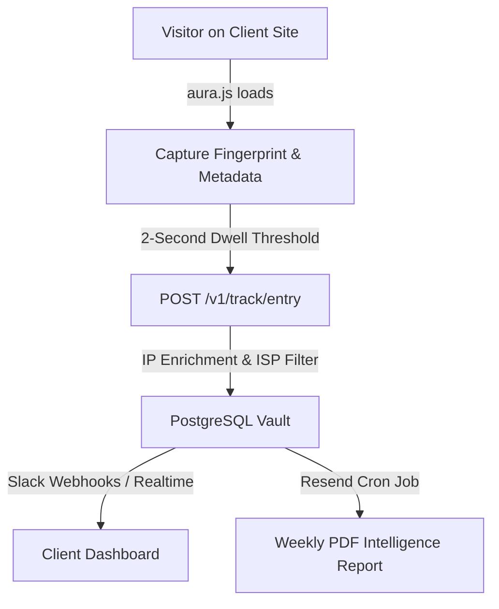

# 🏭 Industrial Intelligence Engine (Master)

> [!WARNING]
> **Proprietary Software Notice:** This repository is private. Unauthorized copying, distribution, or use of any file within this repository is strictly prohibited. All rights reserved.

The **Industrial Intelligence Engine** is a high-performance, privacy-first B2B intent-tracking SaaS. Engineered specifically for the South African industrial and manufacturing sectors, it unmasks anonymous B2B website traffic—transforming raw network packets and IP addresses into high-fidelity, boardroom-ready sales leads.

---

## 📂 Project Architecture

```text
industrial-intelligence/
├── backend/       # FastAPI + SQLModel + PostgreSQL (The Core Intelligence Engine)
├── frontend/      # Next.js 14+ App Router + Tailwind (The Interface & Lead Funnel)
├── tracker/       # Vanilla JS (The Forensic Edge Script)
└── infra/         # Docker Compose, Nginx, and Deployment Orchestration
```

---

## 🛰️ How It Works (The Data Loop)



1. **Capture:** The ultra-lightweight (`<1KB`) `aura.js` client-side script executes on a host site.
2. **Qualify:** Behavioral gating ensures enrichment calls only fire after 2 seconds of verified human interaction (cursor trajectory and scroll velocity analysis).
3. **Deanonymize:** The FastAPI backend receives the ping, performs deterministic GPU/clock-drift fingerprinting, queries **IPinfo**, and blacklists consumer ISPs (**MTN, Vodacom, Telkom, Rain, Afrihost**).
4. **Persist & Encrypt:** Validated B2B sessions are encrypted at-rest using **AES-256** and saved to the PostgreSQL database.
5. **Activate:** Real-time hot-leads are pushed to Slack (`#hot-leads`), while detailed summaries are delivered weekly via automated PDF reports.

---

## ⚡ Quick Start (Local Development)

### 1. Prerequisites
Ensure you are running **WSL 2** (Ubuntu recommended) with **Docker Desktop** active and integrated.

### 2. Set Up Infrastructure
Spin up the local PostgreSQL database:
```bash
docker compose up -d
```

### 3. Spin Up the Core (Backend)
Using `uv` for lightning-fast Python dependency management:
```bash
cd backend
uv venv
source .venv/bin/activate
uv run uvicorn app.main:app --reload
```
* **Interactive API Docs:** [http://localhost:8000/docs](http://localhost:8000/docs)

### 4. Run the Dashboard (Frontend)
```bash
cd frontend/src
npm install
npm run dev
```
* **Dashboard Portal:** [http://localhost:3000](http://localhost:3000)

---

## 🛠️ The "Holy" Tech Stack

* **Core Engine:** FastAPI (Python 3.12+), SQLModel (Pydantic + SQLAlchemy), Uvicorn.
* **Interface Portal:** Next.js 14/15 (App Router, TypeScript, React Server Components), Tailwind CSS, Shadcn/UI.
* **Identity Resolution:** Custom Vanilla ES6+ Tracking Script with canvas-unmasking and bot-traps.
* **Storage Layer:** PostgreSQL (Neon.tech serverless in Production), local Docker instance, Redis cache.
* **Compliance & Legal:** Engineered under strict POPIA (South Africa) and GDPR standards. Purges non-essential consumer ISP traffic; encrypts all PII (email, phone, precise GPS coords).

---

## 💼 Commercial Framework

* **Retainer:** Flat-rate **R10,000/month (R120,000/year)** base retainer.
* **Usage Caps:** Includes up to **10,000 resolved B2B identities** per month.
* **Service Level Guarantee:** Guaranteed minimum **30% Identity Resolution Rate** for unique B2B visitors, backed by pro-rata billing adjustments.
* **Legal Officer:** Reitumetse Sethabela (Founder / Agency Owner).

---

## ⚖️ License

**Copyright (c) 2026 AuraWorks Pty (ltd). All Rights Reserved.**
Unauthorized copying, modification, or redistribution of this repository is strictly prohibited. Use is granted solely to active subscribers of the Industrial Intelligence Engine.