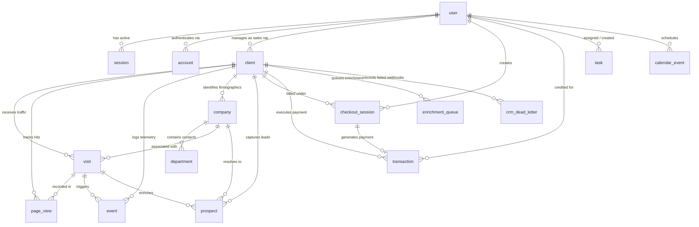

# 🗄️ AuraWorks Industrial Intelligence — Database Structure Specification

> **Database Engine:** PostgreSQL 16+ (Hosted on Neon / Railway)  
> **ORM & Drivers:** SQLModel / SQLAlchemy (Python FastAPI Backend) & Better Auth / node-pg (Next.js Frontend)

This document provides a comprehensive structural reference for all 22 tables comprising the AuraWorks Industrial Intelligence unified data layer.

---

## 🏛️ Architecture Overview

The database is shared directly between:
1. **Next.js Frontend / Better Auth:** Directly queries the auth domain (`"user"`, `"session"`, `"account"`, `"verification"`).
2. **FastAPI Backend (SQLModel):** Handles real-time telemetry ingestion, lead enrichment, client multi-tenancy, billing, CRM pipelines, and background janitor cascades.

### Entity-Relationship Diagram (ERD)

---

## 🔐 1. Authentication & Identity Domain

> [!NOTE]
> PostgreSQL reserved keywords (`user`, `session`, `account`) are double-quoted in all queries.

### `user`
Primary user table shared by Better Auth and FastAPI for Role-Based Access Control (RBAC).

| Column Name | SQL Type | Modifiers / Constraints | Description |
| :--- | :--- | :--- | :--- |
| `id` | `VARCHAR` | `PRIMARY KEY` | Unique user ID (e.g. `usr_...` or UUID) |
| `name` | `VARCHAR` | `NOT NULL`, Default: `'AuraWorks User'` | Full display name |
| `email` | `VARCHAR` | `NOT NULL`, `UNIQUE`, `INDEX` | Work email address |
| `emailVerified` | `BOOLEAN` | `NOT NULL`, Default: `false` | Email verification flag |
| `image` | `VARCHAR` | `NULLABLE` | Avatar image URL |
| `jobTitle` | `VARCHAR` | `NULLABLE` | Job position / title |
| `role` | `VARCHAR` | `NOT NULL`, `INDEX`, Default: `'sales'` | Access role: `'admin'` or `'sales'` |
| `permissions` | `JSON / JSONB` | `NULLABLE`, Default: `["analytics", "sales"]` | Granular permission scopes |
| `is_active` | `BOOLEAN` | `NOT NULL`, `INDEX`, Default: `true` | Account active status |
| `client_id` | `UUID` | `NULLABLE`, `INDEX` | Associated client tenant (if restricted) |
| `createdAt` | `TIMESTAMPTZ` | `NOT NULL`, Default: `NOW()` | Account creation timestamp |
| `updatedAt` | `TIMESTAMPTZ` | `NOT NULL`, Default: `NOW()` | Last profile update timestamp |

---

### `account`
Credentials and OAuth provider links managed by Better Auth.

| Column Name | SQL Type | Modifiers / Constraints | Description |
| :--- | :--- | :--- | :--- |
| `id` | `VARCHAR` | `PRIMARY KEY` | Account record identifier |
| `userId` | `VARCHAR` | `NOT NULL`, `INDEX`, `FK -> "user"(id) ON DELETE CASCADE` | Associated user |
| `accountId` | `VARCHAR` | `NOT NULL` | Provider-specific account ID or email |
| `providerId` | `VARCHAR` | `NOT NULL` | `'credential'`, `'google'`, `'github'`, or `'microsoft'` |
| `password` | `VARCHAR` | `NULLABLE` | Password hash (`scrypt: ${salt_hex}:${key_hex}`) |
| `accessToken` | `TEXT` | `NULLABLE` | OAuth access token |
| `refreshToken` | `TEXT` | `NULLABLE` | OAuth refresh token |
| `accessTokenExpiresAt`| `TIMESTAMPTZ` | `NULLABLE` | OAuth token expiration |
| `refreshTokenExpiresAt`| `TIMESTAMPTZ` | `NULLABLE` | OAuth refresh token expiration |
| `scope` | `VARCHAR` | `NULLABLE` | OAuth granted scopes |
| `idToken` | `TEXT` | `NULLABLE` | OpenID Connect ID token |
| `createdAt` | `TIMESTAMPTZ` | `NOT NULL`, Default: `NOW()` | Record created |
| `updatedAt` | `TIMESTAMPTZ` | `NOT NULL`, Default: `NOW()` | Record updated |

---

### `session`
Active authenticated sessions.

| Column Name | SQL Type | Modifiers / Constraints | Description |
| :--- | :--- | :--- | :--- |
| `id` | `VARCHAR` | `PRIMARY KEY` | Session ID |
| `userId` | `VARCHAR` | `NOT NULL`, `INDEX`, `FK -> "user"(id) ON DELETE CASCADE` | Associated user |
| `token` | `VARCHAR` | `NOT NULL`, `UNIQUE`, `INDEX` | Better Auth session token string |
| `expiresAt` | `TIMESTAMPTZ` | `NOT NULL` | Expiration timestamp |
| `ipAddress` | `VARCHAR` | `NULLABLE` | Client IP address at login |
| `userAgent` | `VARCHAR` | `NULLABLE` | Client browser User-Agent |
| `createdAt` | `TIMESTAMPTZ` | `NOT NULL`, Default: `NOW()` | Session started |
| `updatedAt` | `TIMESTAMPTZ` | `NOT NULL`, Default: `NOW()` | Session refreshed |

---

### `verification`
One-time email verification and password reset tokens.

| Column Name | SQL Type | Modifiers / Constraints | Description |
| :--- | :--- | :--- | :--- |
| `id` | `VARCHAR` | `PRIMARY KEY` | Verification entry ID |
| `identifier` | `VARCHAR` | `NOT NULL`, `INDEX` | Target email or token identifier |
| `value` | `VARCHAR` | `NOT NULL` | Cryptographic verification token |
| `expiresAt` | `TIMESTAMPTZ` | `NOT NULL` | Token expiration |
| `createdAt` | `TIMESTAMPTZ` | `NOT NULL`, Default: `NOW()` | Created |
| `updatedAt` | `TIMESTAMPTZ` | `NOT NULL`, Default: `NOW()` | Updated |

---

### `admin_user`
Legacy standalone admin credentials table (FastAPI direct authentication fallback).

| Column Name | SQL Type | Modifiers / Constraints | Description |
| :--- | :--- | :--- | :--- |
| `id` | `UUID` | `PRIMARY KEY` (UUIDv7) | Admin user ID |
| `email` | `VARCHAR` | `NOT NULL`, `UNIQUE`, `INDEX` | Admin email |
| `hashed_password` | `VARCHAR` | `NOT NULL` | Scrypt password hash |
| `created_at` | `TIMESTAMPTZ` | `NOT NULL`, Default: `NOW()` | Created timestamp |

---

## 🏢 2. Tenant & Client Management

### `client`
B2B client tenants deploying the AuraWorks tracking pixel.

| Column Name | SQL Type | Modifiers / Constraints | Description |
| :--- | :--- | :--- | :--- |
| `id` | `UUID` | `PRIMARY KEY` (UUIDv7) | Client tenant identifier |
| `company_name` | `VARCHAR` | `NOT NULL`, `INDEX` | Tenant organization name |
| `contact_email` | `VARCHAR` | `NULLABLE` | Primary account email |
| `contact_phone` | `VARCHAR` | `NULLABLE` | Primary contact phone |
| `sales_rep_id` | `VARCHAR` | `NULLABLE`, `INDEX`, `FK -> "user"(id)` | Assigned sales executive |
| `domain` | `VARCHAR` | `NULLABLE`, `INDEX` | Primary operating domain |
| `whitelisted_domains`| `VARCHAR[]` | `NOT NULL`, Default: `[]` | Allowed tracking origin domains |
| `category` | `VARCHAR` | Default: `'commercial'` | `'industrial'` or `'commercial'` |
| `client_product_description`| `TEXT` | Default: `""` | Product summary for intent matching |
| `subscription_status`| `VARCHAR` | Default: `'suspended'` | `'trial'`, `'active'`, `'suspended'`, `'cancellation_pending'` |
| `payment_plan` | `VARCHAR` | Default: `'monthly'` | Billing tier |
| `setup_fee_paid` | `BOOLEAN` | Default: `false` | Setup fee clearance flag |
| `contract_signed_at`| `TIMESTAMPTZ` | `NULLABLE` | Digital contract sign timestamp |
| `payment_provider_id`| `VARCHAR` | `NULLABLE` | PayGenius or gateway customer ref |
| `is_active` | `BOOLEAN` | Default: `false` | Ingestion enabled flag |
| `collect_personal_data`| `BOOLEAN` | Default: `false` | POPIA natural person opt-in |
| `require_consent_banner`| `BOOLEAN` | Default: `true` | Enforce banner before personal data capture |
| `slack_webhook_url` | `VARCHAR` | `NULLABLE` | Slack alert dispatch endpoint |
| `crm_webhook_url` | `VARCHAR` | `NULLABLE` | External CRM ingest webhook |
| `airtable_base_id` | `VARCHAR` | `NULLABLE` | Airtable synchronization base |
| `airtable_api_key` | `VARCHAR` | `NULLABLE` | Airtable API key |
| `payment_method_token`| `VARCHAR` | `NULLABLE` | Stored payment token |
| `custom_monthly_amount`| `INTEGER` | `NULLABLE` | Overridden monthly rate (in cents) |
| `billing_cycle` | `VARCHAR` | Default: `'monthly'` | Billing cadence |
| `trial_ends_at` | `TIMESTAMPTZ` | `NULLABLE` | Trial termination date |
| `tc_accepted_at` | `TIMESTAMPTZ` | `NULLABLE` | Terms & Conditions acceptance timestamp |
| `tc_accepted_ip` | `VARCHAR` | `NULLABLE` | Terms & Conditions sign IP |
| `cancellation_requested`| `BOOLEAN` | Default: `false` | Tenant cancellation flag |
| `trial_warning_sent` | `BOOLEAN` | Default: `false` | Warning email dispatch flag |
| `theme_config` | `JSONB` | `NULLABLE` | Custom branding & CSS configurations |
| `created_at` | `TIMESTAMPTZ` | `NOT NULL`, Default: `NOW()` | Registration timestamp |
| `auto_classified_at`| `TIMESTAMPTZ` | `NULLABLE` | Auto-classification run date |

---

## 🛰️ 3. Forensic Edge Tracking & Visitor Telemetry

### `visit`
Forensic multi-tenant visitor sessions captured by `aura.js`.

| Column Name | SQL Type | Modifiers / Constraints | Description |
| :--- | :--- | :--- | :--- |
| `id` | `UUID` | `PRIMARY KEY` (UUIDv7) | Visit session ID |
| `client_id` | `UUID` | `NOT NULL`, `INDEX`, `FK -> client(id) ON DELETE CASCADE` | Client tenant ID |
| `company_id` | `UUID` | `NULLABLE`, `INDEX`, `FK -> company(id) ON DELETE CASCADE` | Identified corporate entity |
| `aura_id` | `VARCHAR` | `NOT NULL`, `INDEX` | Persistent browser fingerprint ID |
| `ip_address` | `VARCHAR` | `NOT NULL`, `INDEX` | Visitor IPv4 / IPv6 address |
| `connection_type` | `VARCHAR` | Default: `'corporate'` | `'corporate'`, `'residential'`, `'datacenter'` |
| `is_b2b` | `BOOLEAN` | `NOT NULL`, `INDEX`, Default: `true` | Valid corporate B2B visitor flag |
| `high_intent` | `BOOLEAN` | `NOT NULL`, `INDEX`, Default: `false` | High-intent browsing threshold |
| `verification_status`| `VARCHAR` | `INDEX`, Default: `'verifying'` | `'verifying'`, `'verified'`, `'anonymized_corporate'` |
| `is_consented` | `BOOLEAN` | `NOT NULL`, `INDEX`, Default: `false` | POPIA personal data consent flag |
| `email` | `VARCHAR` | `NULLABLE`, `INDEX` | Visitor email (AES-256 encrypted if unconsented) |
| `visitor_name` | `VARCHAR` | `NULLABLE` | Captured visitor full name |
| `canvas_hash` | `VARCHAR` | `NULLABLE` | Hardware Canvas fingerprint |
| `webgl_renderer` | `VARCHAR` | `NULLABLE` | GPU renderer string |
| `clock_drift` | `VARCHAR` | `NULLABLE` | Client-server clock delta |
| `effective_connection_type`| `VARCHAR` | `NULLABLE` | Network speed category (4g, 3g, wifi) |
| `downlink_speed` | `FLOAT` | `NULLABLE` | Network downlink throughput (Mbps) |
| `rtt` | `INTEGER` | `NULLABLE` | Round-trip latency (ms) |
| `fingerprint_hash` | `VARCHAR` | `NULLABLE`, `INDEX` | Composite cryptographic fingerprint |
| `capture_source` | `VARCHAR` | `NULLABLE`, Default: `'banner'` | Ingestion origin (`'banner'`, `'script'`, `'form'`) |
| `duration` | `INTEGER` | `NOT NULL`, Default: `0` | Active session dwell time (seconds) |
| `vsl_completion_percentage`| `INTEGER` | `NULLABLE` | Video sales letter watch progress (0-100%) |
| `vsl_completed_at` | `TIMESTAMPTZ` | `NULLABLE` | Video completion timestamp |
| `vsl_abandoned` | `BOOLEAN` | `NULLABLE`, Default: `false` | Video drop-off flag |
| `intent_cluster` | `VARCHAR` | `NULLABLE`, `INDEX` | Inferred topic interest category |
| `created_at` | `TIMESTAMPTZ` | `NOT NULL`, Default: `NOW()` | Session started |
| `updated_at` | `TIMESTAMPTZ` | `NOT NULL`, Default: `NOW()` | Session last updated |

---

### `page_view`
Granular page route hits.

| Column Name | SQL Type | Modifiers / Constraints | Description |
| :--- | :--- | :--- | :--- |
| `id` | `UUID` | `PRIMARY KEY` (UUIDv7) | Page hit ID |
| `client_id` | `UUID` | `NOT NULL`, `INDEX`, `FK -> client(id) ON DELETE CASCADE` | Client tenant ID |
| `visit_id` | `UUID` | `NOT NULL`, `INDEX`, `FK -> visit(id) ON DELETE CASCADE` | Associated visit ID |
| `url_path` | `VARCHAR` | `NOT NULL`, `INDEX` | Target path (e.g. `/pricing`) |
| `referrer` | `VARCHAR` | `NULLABLE` | HTTP referrer source |
| `duration` | `INTEGER` | `NOT NULL`, Default: `0` | Route dwell time (seconds) |
| `created_at` | `TIMESTAMPTZ` | `NOT NULL`, Default: `NOW()` | Timestamp hit occurred |

---

### `event`
Custom behavior telemetry and interaction logs.

| Column Name | SQL Type | Modifiers / Constraints | Description |
| :--- | :--- | :--- | :--- |
| `id` | `UUID` | `PRIMARY KEY` (UUIDv7) | Event ID |
| `client_id` | `UUID` | `NOT NULL`, `INDEX`, `FK -> client(id) ON DELETE CASCADE` | Client tenant ID |
| `visit_id` | `UUID` | `NOT NULL`, `INDEX`, `FK -> visit(id) ON DELETE CASCADE` | Associated visit ID |
| `event_type` | `VARCHAR` | `NOT NULL`, `INDEX` | Event category (`'cta_click'`, `'download'`, etc.) |
| `properties` | `JSONB` | `NOT NULL`, Default: `{}` | Custom telemetry payload |
| `timestamp` | `TIMESTAMPTZ` | `NOT NULL`, `INDEX`, Default: `NOW()` | Execution timestamp |

---

## 🏢 4. Firmographics & Account Intelligence

### `company`
Corporate directory of identified visiting organizations.

| Column Name | SQL Type | Modifiers / Constraints | Description |
| :--- | :--- | :--- | :--- |
| `id` | `UUID` | `PRIMARY KEY` (UUIDv7) | Company ID |
| `client_id` | `UUID` | `NOT NULL`, `INDEX`, `FK -> client(id) ON DELETE CASCADE` | Client tenant ID |
| `domain` | `VARCHAR` | `NOT NULL`, `INDEX` | Corporate website domain |
| `company_name` | `VARCHAR` | `NOT NULL`, `INDEX` | Official business name |
| `industry` | `VARCHAR` | `NULLABLE`, `INDEX` | Industry sector |
| `parent_company_id`| `UUID` | `NULLABLE`, `FK -> company(id)` | Holding company reference |
| `is_headquarters` | `BOOLEAN` | Default: `false` | HQ identification |
| `intent_summary` | `TEXT` | `NULLABLE` | Synthesized purchase intent overview |
| `last_enrichment_attempt`| `TIMESTAMPTZ` | `NULLABLE` | Last API enrichment run |
| `cipc_verified` | `BOOLEAN` | Default: `false` | South African CIPC registration match |
| `cipc_registration_number`| `VARCHAR` | `NULLABLE` | Official CIPC company reg number |
| `total_visits` | `INTEGER` | `NOT NULL`, `INDEX`, Default: `0` | Aggregate visits recorded |
| `created_at` | `TIMESTAMPTZ` | `NOT NULL`, Default: `NOW()` | Created timestamp |

> **Constraint:** `UNIQUE (client_id, domain)` — ensures domain uniqueness per tenant.

---

### `department`
Key organizational contacts and corporate department heads.

| Column Name | SQL Type | Modifiers / Constraints | Description |
| :--- | :--- | :--- | :--- |
| `id` | `UUID` | `PRIMARY KEY` (UUIDv7) | Contact entry ID |
| `company_id` | `UUID` | `NOT NULL`, `INDEX`, `FK -> company(id) ON DELETE CASCADE` | Target company |
| `contact_name` | `VARCHAR` | `NOT NULL` | Individual's full name |
| `role_title` | `VARCHAR` | `NOT NULL`, `INDEX` | Job position / seniority |
| `email` | `VARCHAR` | `NOT NULL` | Verified corporate email |
| `phone` | `VARCHAR` | `NULLABLE` | Direct telephone / switchboard |
| `linkedin_url` | `VARCHAR` | `NULLABLE` | LinkedIn profile URL |
| `priority_score` | `INTEGER` | `NOT NULL`, `INDEX`, Range: 1-5 | Decision-making authority priority |
| `created_at` | `TIMESTAMPTZ` | `NOT NULL`, Default: `NOW()` | Created timestamp |

---

### `prospect`
Qualified inbound demo requests and leads.

| Column Name | SQL Type | Modifiers / Constraints | Description |
| :--- | :--- | :--- | :--- |
| `id` | `UUID` | `PRIMARY KEY` (UUIDv7) | Prospect ID |
| `client_id` | `UUID` | `NOT NULL`, `INDEX`, `FK -> client(id) ON DELETE CASCADE` | Client tenant |
| `company_id` | `UUID` | `NULLABLE`, `INDEX`, `FK -> company(id)` | Matched company entity |
| `name` | `VARCHAR` | `NULLABLE` | Contact name |
| `email` | `VARCHAR` | `NOT NULL`, `INDEX` | Work email |
| `phone_encrypted` | `VARCHAR` | `NULLABLE` | AES-256 encrypted phone number |
| `company_name_raw` | `VARCHAR` | `NULLABLE` | Unnormalized form input |
| `department` | `VARCHAR` | `NULLABLE` | Functional department |
| `position` | `VARCHAR` | `NULLABLE` | Title / Job rank |
| `industry` | `VARCHAR` | `NULLABLE` | Form-declared industry |
| `website` | `VARCHAR` | `NULLABLE` | Declared website |
| `traffic` | `VARCHAR` | `NULLABLE` | Self-reported monthly traffic |
| `avg_price` | `VARCHAR` | `NULLABLE` | Average deal size |
| `crm` | `VARCHAR` | `NULLABLE` | Existing CRM in use |
| `aura_id` | `VARCHAR` | `NULLABLE`, `INDEX` | Linked session aura_id |
| `welcome_email_sent`| `BOOLEAN` | Default: `false` | Welcome email dispatch status |
| `status` | `VARCHAR` | `NOT NULL`, `INDEX`, Default: `'demo_requested'` | `'demo_requested'`, `'call_booked'` |
| `calendly_event_uuid`| `VARCHAR` | `NULLABLE`, `INDEX` | Associated Calendly booking UUID |
| `vsl_completion_percentage`| `INTEGER` | `NULLABLE` | VSL watch progress |
| `vsl_completed_at` | `TIMESTAMPTZ` | `NULLABLE` | VSL completion timestamp |
| `vsl_abandoned` | `BOOLEAN` | `NULLABLE`, Default: `false` | VSL abandon flag |
| `created_at` | `TIMESTAMPTZ` | `NOT NULL`, Default: `NOW()` | Created timestamp |
| `updated_at` | `TIMESTAMPTZ` | `NOT NULL`, Default: `NOW()` | Updated timestamp |

---

## 💳 5. Billing & Commerce Domain

### `checkout_session`
Self-serve checkout payment links generated by sales reps.

| Column Name | SQL Type | Modifiers / Constraints | Description |
| :--- | :--- | :--- | :--- |
| `id` | `UUID` | `PRIMARY KEY` (UUIDv7) | Checkout session ID |
| `client_id` | `UUID` | `NOT NULL`, `INDEX`, `FK -> client(id)` | Target tenant |
| `sales_rep_id` | `VARCHAR` | `NOT NULL`, `INDEX`, `FK -> "user"(id)` | Sales representative |
| `status` | `VARCHAR` | `NOT NULL`, `INDEX`, Default: `'pending'` | `'pending'`, `'paid'`, `'expired'` |
| `expires_at` | `TIMESTAMPTZ` | `NOT NULL` | Checkout link expiration (typically 48 hrs) |
| `amount` | `INTEGER` | `NOT NULL`, Default: `1000000` | Price in cents (ZAR 10,000.00 default) |
| `plan` | `VARCHAR` | `NOT NULL`, Default: `'monthly'` | Plan tier |
| `business_name` | `VARCHAR` | `NULLABLE` | Buyer business name |
| `contact_email` | `VARCHAR` | `NULLABLE` | Buyer billing email |
| `contact_phone` | `VARCHAR` | `NULLABLE` | Buyer billing phone |
| `created_at` | `TIMESTAMPTZ` | `NOT NULL`, Default: `NOW()` | Created timestamp |
| `updated_at` | `TIMESTAMPTZ` | `NOT NULL`, Default: `NOW()` | Updated timestamp |

---

### `transaction`
Payment transactions executed via PayGenius gateway.

| Column Name | SQL Type | Modifiers / Constraints | Description |
| :--- | :--- | :--- | :--- |
| `id` | `UUID` | `PRIMARY KEY` (UUIDv7) | Transaction ID |
| `client_id` | `UUID` | `NOT NULL`, `INDEX`, `FK -> client(id)` | Client tenant |
| `sales_rep_id` | `VARCHAR` | `NULLABLE`, `INDEX`, `FK -> "user"(id)` | Credited sales rep |
| `checkout_session_id`| `UUID` | `NULLABLE`, `INDEX`, `FK -> checkout_session(id)` | Origin checkout link |
| `amount` | `INTEGER` | `NOT NULL` | Amount billed (in cents) |
| `currency` | `VARCHAR` | `NOT NULL`, Default: `'ZAR'` | Currency denomination |
| `status` | `VARCHAR` | `NOT NULL`, `INDEX`, Default: `'pending'` | `'pending'`, `'successful'`, `'failed'`, `'refunded'` |
| `gateway_reference`| `VARCHAR` | `NOT NULL`, `UNIQUE`, `INDEX` | Gateway transaction ref |
| `payment_method_token`| `VARCHAR` | `NOT NULL` | Reusable token for recurring subscriptions |
| `error_message` | `VARCHAR` | `NULLABLE` | Gateway error code or reason |
| `created_at` | `TIMESTAMPTZ` | `NOT NULL`, Default: `NOW()` | Created timestamp |
| `updated_at` | `TIMESTAMPTZ` | `NOT NULL`, Default: `NOW()` | Updated timestamp |

---

## 📋 6. CRM & Pipeline Domain

### `task`
Pipeline tasks and action items for sales team members.

| Column Name | SQL Type | Modifiers / Constraints | Description |
| :--- | :--- | :--- | :--- |
| `id` | `VARCHAR` | `PRIMARY KEY` | Task ID |
| `title` | `VARCHAR` | `NOT NULL` | Task title |
| `description` | `TEXT` | `NULLABLE` | Task notes |
| `status` | `VARCHAR` | `NOT NULL`, `INDEX`, Default: `'todo'` | `'todo'`, `'in_progress'`, `'done'` |
| `priority` | `VARCHAR` | `NOT NULL`, Default: `'medium'` | `'low'`, `'medium'`, `'high'`, `'urgent'` |
| `due_date` | `TIMESTAMPTZ` | `NULLABLE` | Deadline |
| `assigned_to_id`| `VARCHAR` | `NULLABLE`, `INDEX`, `FK -> "user"(id) ON DELETE SET NULL` | Assignee |
| `created_by_id` | `VARCHAR` | `NOT NULL`, `INDEX`, `FK -> "user"(id) ON DELETE CASCADE` | Creator |
| `created_at` | `TIMESTAMPTZ` | `NOT NULL`, Default: `NOW()` | Created timestamp |
| `updated_at` | `TIMESTAMPTZ` | `NOT NULL`, Default: `NOW()` | Updated timestamp |

---

### `calendar_event`
Sales appointments and CRM calendar bookings.

| Column Name | SQL Type | Modifiers / Constraints | Description |
| :--- | :--- | :--- | :--- |
| `id` | `VARCHAR` | `PRIMARY KEY` | Event ID |
| `title` | `VARCHAR` | `NOT NULL` | Meeting title |
| `start_time` | `TIMESTAMPTZ` | `NOT NULL` | Meeting start |
| `end_time` | `TIMESTAMPTZ` | `NULLABLE` | Meeting end |
| `all_day` | `BOOLEAN` | `NOT NULL`, Default: `false` | All-day event flag |
| `category` | `VARCHAR` | `NOT NULL`, Default: `'primary'` | Badge styling (`'primary'`, `'success'`, `'danger'`, etc.) |
| `user_id` | `VARCHAR` | `NOT NULL`, `INDEX`, `FK -> "user"(id) ON DELETE CASCADE` | Event owner |
| `created_at` | `TIMESTAMPTZ` | `NOT NULL`, Default: `NOW()` | Created timestamp |
| `updated_at` | `TIMESTAMPTZ` | `NOT NULL`, Default: `NOW()` | Updated timestamp |

---

### `inbound_message`
Direct contact form submissions and inbound inquiries.

| Column Name | SQL Type | Modifiers / Constraints | Description |
| :--- | :--- | :--- | :--- |
| `id` | `UUID` | `PRIMARY KEY` (UUIDv7) | Message ID |
| `sender_email` | `VARCHAR` | `NOT NULL`, `INDEX` | Sender address |
| `recipient_alias`| `VARCHAR` | `NOT NULL`, `INDEX` | Target inbox (`sales@auraworks.co.za`) |
| `subject` | `VARCHAR` | `NOT NULL` | Subject header |
| `text_body` | `TEXT` | `NULLABLE` | Plaintext content |
| `html_body` | `TEXT` | `NULLABLE` | Rich HTML body |
| `status` | `VARCHAR` | `NOT NULL`, `INDEX`, Default: `'unread'` | `'unread'`, `'in_progress'`, `'resolved'` |
| `created_at` | `TIMESTAMPTZ` | `NOT NULL`, Default: `NOW()` | Timestamp received |

---

## ⚡ 7. Background Queues & Infrastructure

### `enrichment_queue` & `failed_enrichment`
Async worker queues resolving IPinfo network telemetry and Apollo contact intelligence.

| Column Name | SQL Type | Modifiers / Constraints | Description |
| :--- | :--- | :--- | :--- |
| `id` | `UUID` | `PRIMARY KEY` (UUIDv7) | Job ID |
| `client_id` | `UUID` | `NOT NULL`, `INDEX`, `FK -> client(id)` | Target tenant |
| `visit_id` | `UUID` | `NULLABLE`, `INDEX` | Visit session |
| `aura_id` | `VARCHAR` | `NULLABLE`, `INDEX` | Browser fingerprint |
| `queue_type` | `VARCHAR` | `NOT NULL`, `INDEX` | `'ipinfo'` or `'apollo'` |
| `payload` | `JSONB` | `NOT NULL` | Ingestion payload |
| `status` | `VARCHAR` | `NOT NULL`, `INDEX`, Default: `'pending'` | `'pending'`, `'processing'`, `'completed'` |
| `retry_count` | `INTEGER` | `NOT NULL`, `INDEX`, Default: `0` | Failed attempts count |
| `last_attempt_at`| `TIMESTAMPTZ` | `NULLABLE` | Timestamp of last worker run |
| `next_attempt_at`| `TIMESTAMPTZ` | `NULLABLE` | Exponential backoff scheduled time |
| `created_at` | `TIMESTAMPTZ` | `NOT NULL`, Default: `NOW()` | Ingested into queue |

---

### `crm_dead_letter`
Dead-letter archive capturing failed webhook deliveries and external CRM dispatches.

| Column Name | SQL Type | Modifiers / Constraints | Description |
| :--- | :--- | :--- | :--- |
| `id` | `UUID` | `PRIMARY KEY` (UUIDv7) | Record ID |
| `client_id` | `UUID` | `NOT NULL`, `INDEX`, `FK -> client(id)` | Target tenant |
| `payload` | `JSONB` | `NOT NULL` | Outgoing payload that failed delivery |
| `attempts` | `INTEGER` | `NOT NULL`, Default: `0` | Number of failed delivery attempts |
| `last_error` | `TEXT` | `NULLABLE` | HTTP status code or timeout stack trace |
| `created_at` | `TIMESTAMPTZ` | `NOT NULL`, Default: `NOW()` | First queued |
| `failed_at` | `TIMESTAMPTZ` | `NOT NULL`, Default: `NOW()` | Moved to dead letter |

---

### `notification_throttle`
Rate-limiting tracker preventing notification spam (Slack / Email alerts).

| Column Name | SQL Type | Modifiers / Constraints | Description |
| :--- | :--- | :--- | :--- |
| `id` | `UUID` | `PRIMARY KEY` (UUIDv7) | Throttle ID |
| `client_id` | `UUID` | `NOT NULL`, `INDEX`, `FK -> client(id)` | Target tenant |
| `company_id` | `UUID` | `NOT NULL`, `INDEX` | Identified visiting company |
| `last_notification_sent_at`| `TIMESTAMPTZ` | `NOT NULL`, Default: `NOW()` | Timestamp of last sent notification |
| `created_at` | `TIMESTAMPTZ` | `NOT NULL`, Default: `NOW()` | Record created |
