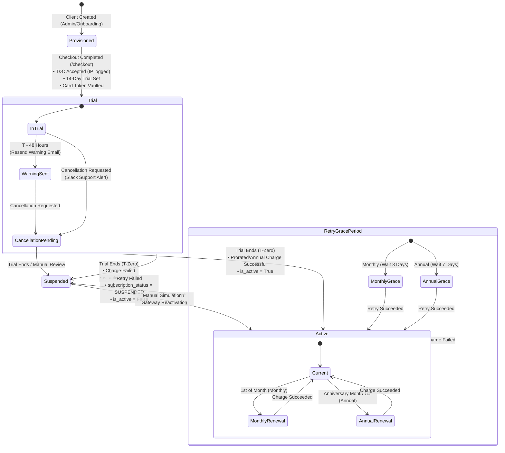
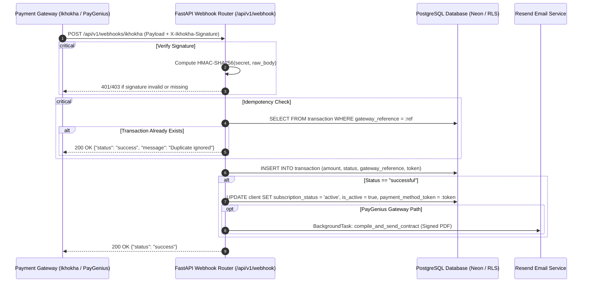
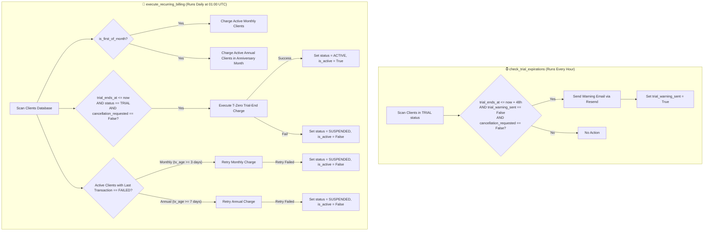

# 💳 AuraWorks Industrial Intelligence — Payments & Billing Architecture

> **Document Classification:** Engineering Architecture & Operational Workflow Spec  
> **System Scope:** Backend (FastAPI / SQLModel / APScheduler), Frontend (Next.js 14+ App Router), Payment Gateways (Ikhokha API & PayGenius Webhook), and Email Infrastructure (Resend).  
> **Currency Baseline:** South African Rand (ZAR) — all currency values stored and processed in **integer cents** (e.g. `R10,000.00` = `1000000` cents).

---

## 1. Executive Summary & Architectural Overview

The AuraWorks billing system manages enterprise B2B subscriptions for industrial intelligence and visitor de-anonymization services across South Africa and the SADC region. 

The payment engine is architected around a **14-Day Risk-Free Trial Model** paired with **card tokenization** for automated recurring billing:
1. **Zero Upfront Charge:** During onboarding, clients accept Terms & Conditions and complete card verification through a secure payment gateway vault without an immediate full subscription debit.
2. **Tokenized Vault Storage:** The gateway returns an encrypted payment method token (`payment_method_token`) that is persisted in the client's record.
3. **Automated 48-Hour Pre-Expiry Warnings:** Exactly 48 hours before trial completion, an automated email warning is dispatched via Resend providing a transparent self-service cancellation link.
4. **T-Zero Automated Conversion & Prorated Charging:** When the trial ends, a background cron job calculates the prorated first month fee (or full annual fee) and charges the tokenized card.
5. **Recurring Billing & Grace Period Engine:** Active accounts are automatically billed on the 1st of each calendar month (or anniversary month for annual plans), with automated 3-day (monthly) and 7-day (annual) grace-period retry loops before account suspension.

---

## 2. End-to-End Workflow & Lifecycle State Machine



---

## 3. Detailed Component Breakdown: Frontend

### 3.1 Public Pricing Architecture (`/pricing`)
* **Source Component:** `frontend/src/components/pricing/pricing.tsx`
* **Tier Matrix:**
  * **Growth Foundation:** R10,000 / month (or R100,000 / year). Up to 500 corporate accounts unmasked/mo, 45 keywords, weekly PDF digests.
  * **Industrial Category Leader:** R18,500 / month (or R185,000 / year). Uncapped corporate identification, 120 keywords, real-time webhooks (Slack/Teams/HubSpot), GEO & AI engine citations.
  * **Enterprise SADC Corridor:** R32,000 / month (or R320,000 / year). Cross-border multi-region SEO (Zambia, DRC, Mozambique), custom data lakes (Snowflake/BigQuery).
* **Call to Action:** Routes prospective clients to `/book-demo?plan=<tier>` for qualification and provisioning.

### 3.2 Client Checkout Funnel (`/checkout`)
* **Source Component:** `frontend/src/app/checkout/page.tsx`
* **Test Suite:** `frontend/src/app/checkout/checkout.test.tsx`
* **Workflow Behavior:**
  1. **Query Ingestion:** Reads `client_id` from search parameters (`/checkout?client_id=<UUID>`).
  2. **Audit Footprint Ingestion:** On component mount, queries `https://api.ipify.org?format=json` to determine the visitor's public IPv4/IPv6 address for legal audit logging.
  3. **Billing Interval Selection:** Interactive toggle between **Monthly** (`R10,000 / mo` -> `1000000` cents) and **Annual** (`R120,000 / yr` -> `12000000` cents).
  4. **Terms & Conditions Enforcement:** Checkbox gating button activation. Gathers explicit legal consent for recurring billing following the 14-day trial period.
  5. **Backend Dispatch:** Sends `POST` request to `/api/v1/billing/setup`:
     ```json
     {
       "client_id": "3fa85f64-5717-4562-b3fc-2c963f66afa6",
       "amount": 1000000,
       "redirect_url": "https://auraworks.co.za/admin?client_id=...&checkout=success",
       "billing_cycle": "monthly",
       "tc_accepted": true,
       "tc_accepted_ip": "197.x.x.x"
     }
     ```
  6. **Payment Gateway Handoff:** Reads `payment_url` from response and redirects client to the hosted Ikhokha Payment Gateway vault.

### 3.3 Admin Control Console (`/aurahq/admin`)
* **Source Component:** `frontend/src/app/(authenticated)/aurahq/admin/page.tsx`
* **Features & Billing Management:**
  * **Status Filter Tabs:** Filter client accounts by `all`, `active`, `trial`, `suspended`, or `cancellation_pending`.
  * **Billing Configuration Tab:**
    * Configure `payment_plan` (`monthly`, `annual`, `enterprise`).
    * Set `custom_monthly_amount` in ZAR (converted to cents before `PATCH /api/v1/clients/{id}`).
  * **Transaction History Query:** Loads ledger logs via `GET /api/v1/billing/transactions?client_id={id}`.
  * **Simulation Tooling:** Ability to trigger mock webhook events for local QA and verification.

---

## 4. Detailed Component Breakdown: Backend

### 4.1 Billing Router (`/api/v1/billing`)
* **Source File:** `backend/app/api/v1/billing.py`
* **Test Suite:** `backend/tests/test_billing.py`

| Endpoint | Method | Auth | Description |
| :--- | :--- | :--- | :--- |
| `/api/v1/billing/setup` | `POST` | Admin / Client User | Validates T&C, records IP & timestamp, sets 14-day trial, requests payment intent from Ikhokha. |
| `/api/v1/billing/transactions` | `GET` | Admin / Client User | Fetches historical `Transaction` records for `client_id` ordered by `created_at DESC`. |
| `/api/v1/billing/cancel-request` | `POST` / `GET` | Public / Link | Sets `subscription_status = CANCELLATION_PENDING`, `cancellation_requested = True`, notifies Slack. |
| `/api/v1/billing/simulate-webhook`| `POST` | Superuser / Admin | Development utility simulating Ikhokha payment events to update ledger & client status. |

#### Detailed Setup Logic (`POST /api/v1/billing/setup`):
```python
# 1. Enforce Multi-Tenant Access Boundaries
if not current_user.is_superuser:
    if current_user.client_id != payload.client_id:
        raise HTTPException(status_code=403, detail="Tenant data access violation.")

# 2. Enforce Legal Acceptance
if not payload.tc_accepted:
    raise HTTPException(status_code=400, detail="Terms & Conditions must be accepted.")

# 3. Update Client to 14-Day Trial
client.billing_cycle = payload.billing_cycle
client.tc_accepted_at = datetime.now(timezone.utc)
client.tc_accepted_ip = payload.tc_accepted_ip or request.client.host
client.subscription_status = SubscriptionStatus.TRIAL
client.trial_ends_at = datetime.now(timezone.utc) + timedelta(days=14)
client.is_active = True

# 4. Request Payment Intent from Gateway
ik_client = IkhokhaClient()
intent = await ik_client.create_payment_intent(
    client_id=client.id,
    amount=payload.amount or client.custom_monthly_amount or 1000000,
    redirect_url=payload.redirect_url
)
```

---

### 4.2 Webhook Ingestion & Idempotency (`/api/v1/webhook`)
* **Source File:** `backend/app/api/v1/webhook.py`



#### Key Webhook Implementations:
1. **Ikhokha Webhook (`POST /api/v1/webhooks/ikhokha`):**
   * Verifies `X-Ikhokha-Signature` against `settings.IKHOKHA_WEBHOOK_SECRET` via `hmac.compare_digest`.
   * Enforces strict idempotency by rejecting duplicate `gateway_reference` entries.
   * Records transaction entry in `transaction` table.
   * On success, sets `client.subscription_status = SubscriptionStatus.ACTIVE`, `client.is_active = True`, and stores `client.payment_method_token`.
2. **PayGenius Webhook (`POST /api/v1/webhook/paygenius`):**
   * Verifies `X-Signature` / `X-Paygenius-Signature` header via HMAC-SHA256.
   * Sets `client.subscription_status = SubscriptionStatus.ACTIVE` and `client.setup_fee_paid = True`.
   * Dispatches background task `compile_and_send_contract(...)` to generate a cryptographically signed PDF contract via ReportLab and email it to the client via Resend.

---

### 4.3 Payment Gateway Client Service (`IkhokhaClient`)
* **Source File:** `backend/app/services/payment.py`
* **Test Suite:** `backend/tests/test_payment.py`

The `IkhokhaClient` provides an asynchronous HTTP interface (via `httpx.AsyncClient`) for communication with the Ikhokha gateway:

1. **`get_access_token()`**: Authenticates with `POST /v1/auth/token` using `IKHOKHA_CLIENT_ID` and `IKHOKHA_CLIENT_SECRET`. Returns mock credentials if unconfigured for non-blocking local dev/testing.
2. **`create_payment_intent(client_id, amount, redirect_url)`**: Initiates checkout session with `POST /v1/checkout/intent`, specifying amount in cents, currency as `ZAR`, and webhook callback URL (`https://api.auraworks.co.za/api/v1/webhooks/ikhokha`).
3. **`confirm_payment(gateway_reference)`**: Retrieves live transaction status via `GET /v1/transactions/{gateway_reference}`.
4. **`charge_token(client_id, amount, token)`**: Triggers recurring or trial-end charges against a vaulted payment method token via `POST /v1/checkout/charge-token`.

---

### 4.4 Proration Mathematical Engine
* **Source Function:** `calculate_prorated_amount(trial_ends_at, base_amount)` in `backend/app/services/payment.py`

To ensure fair billing when a 14-day trial concludes mid-month, AuraWorks employs a tiered calendar proration algorithm:

$$\text{Prorated Amount} = \begin{cases} 
\text{base\_amount} & \text{if } 1 \le \text{day} \le 5 \quad (\text{Early Month: Full Month}) \\
\lfloor \frac{\text{base\_amount}}{2} \rfloor & \text{if } 6 \le \text{day} \le 15 \quad (\text{Mid Month: Flat Half Price}) \\
\text{round}\left(\frac{\text{base\_amount}}{\text{days\_in\_month}} \times (\text{days\_in\_month} - \text{day} + 1)\right) & \text{if } \text{day} \ge 16 \quad (\text{Late Month: Daily Rate})
\end{cases}$$

#### Verified Unit Test Assertions:
* **June (30-day month):**
  * June 3rd (Day 3) $\rightarrow$ Full Price: `R10,000.00` (`1,000,000` cents)
  * June 15th (Day 15) $\rightarrow$ Half Price: `R5,000.00` (`500,000` cents)
  * June 25th (Day 25, 6 days remaining) $\rightarrow$ `(1,000,000 / 30) * 6 = R2,000.00` (`200,000` cents)
* **July (31-day month):**
  * July 25th (Day 25, 7 days remaining) $\rightarrow$ `round((1,000,000 / 31) * 7) = R2,258.06` (`225,806` cents)

---

## 5. Automated Background Schedulers & Workers

* **Source File:** `backend/app/core/scheduler.py`
* **Test Suite:** `backend/tests/test_recurring_billing.py`

The background scheduler runs on APScheduler (`AsyncIOScheduler`) with two dedicated billing workers:



### 5.1 Trial Expiration Warning Loop (`check_trial_expirations`)
* **Cadence:** Executes every **1 hour**.
* **Filter Criteria:** `subscription_status == TRIAL`, `trial_warning_sent == False`, `trial_ends_at <= now + 48 hours`, `cancellation_requested == False`.
* **Action:** Dispatches warning email via Resend (`send_trial_warning_email`) with direct cancellation URL (`/cancel-request?client_id={id}`).
* **Commit:** Sets `trial_warning_sent = True` to guarantee single-dispatch idempotency.

### 5.2 Recurring Billing Engine (`execute_recurring_billing`)
* **Cadence:** Executes daily at **01:00 UTC**.
* **Part 1: 1st of Month Renewals:**
  * **Monthly Clients:** Charges `custom_monthly_amount` or default `1000000` cents (R10,000).
  * **Annual Clients:** Checks if current calendar month matches trial anniversary month (`trial_ends_at.month == now.month` and `trial_ends_at.year < now.year`). If matched, charges `12000000` cents (R120,000).
* **Part 2: Trial-End T-Zero Automated Charging:**
  * Charges clients whose `trial_ends_at <= now`.
  * Computes prorated amount for monthly cycles or full charge for annual cycles.
  * Successful charge transitions client to `SubscriptionStatus.ACTIVE` and `is_active = True`.
  * Failed charge transitions client to `SubscriptionStatus.SUSPENDED` and `is_active = False`.
* **Part 3: Grace Period Retries & Suspension Boundaries:**
  * **Monthly Subscriptions:** Failed charges are given a **3-day grace period**. If unrecovered after 3 days, a retry charge is attempted. Failure suspends the account.
  * **Annual Subscriptions:** Failed annual renewals are given a **7-day grace period**. If unrecovered after 7 days, a retry charge is attempted. Failure suspends the account.

---

## 6. Database Models & Schema Reference

### 6.1 `Client` Entity (`backend/app/models/client.py`)

| Field | Type | Default | Description |
| :--- | :--- | :--- | :--- |
| `id` | `UUID` (UUIDv7) | `uuid7()` | Primary Key. |
| `company_name` | `String` | — | Name of client organization. |
| `domain` | `String` | `None` | Primary whitelisted website domain. |
| `subscription_status`| `Enum` | `SUSPENDED` | Values: `trial`, `active`, `suspended`, `cancellation_pending`. |
| `billing_cycle` | `String` | `"monthly"` | Values: `"monthly"`, `"annual"`. |
| `payment_plan` | `String` | `"monthly"` | Values: `"monthly"`, `"annual"`, `"enterprise"`. |
| `custom_monthly_amount`| `Integer` (cents) | `None` | Custom monthly fee override (e.g., `1850000` for R18.5k). |
| `payment_method_token` | `String` | `None` | Encrypted card token returned by Ikhokha Vault. |
| `trial_ends_at` | `DateTime(UTC)` | `None` | Timestamp when 14-day trial expires. |
| `tc_accepted_at` | `DateTime(UTC)` | `None` | Audit timestamp when T&Cs were accepted. |
| `tc_accepted_ip` | `String` | `None` | Client IPv4/IPv6 address during checkout. |
| `trial_warning_sent` | `Boolean` | `False` | Flag tracking 48h warning email dispatch. |
| `cancellation_requested`| `Boolean` | `False` | True if client initiated self-service cancellation. |
| `setup_fee_paid` | `Boolean` | `False` | Flag for one-off onboarding setup fee. |
| `is_active` | `Boolean` | `False` | Master operational switch enabling tracker ingestion. |

### 6.2 `Transaction` Ledger Entity (`backend/app/models/transaction.py`)

| Field | Type | Default | Description |
| :--- | :--- | :--- | :--- |
| `id` | `UUID` (UUIDv7) | `uuid7()` | Primary Key. |
| `client_id` | `UUID` (FK) | — | Foreign key referencing `client.id`. |
| `amount` | `Integer` | — | Transaction value in integer cents. |
| `currency` | `String` | `"ZAR"` | ISO currency code. |
| `status` | `Enum` | `PENDING` | Values: `pending`, `successful`, `failed`, `refunded`. |
| `gateway_reference` | `String` | — | Unique reference from payment gateway (Indexed, Unique). |
| `payment_method_token` | `String` | — | Card token utilized for transaction execution. |
| `error_message` | `String` | `None` | Gateway failure reason (if failed). |
| `created_at` | `DateTime(UTC)` | `now(utc)` | Immutable transaction record creation timestamp. |
| `updated_at` | `DateTime(UTC)` | `now(utc)` | Record update timestamp. |

---

## 7. Security, Compliance & POPIA Guardrails

1. **Cryptographic Webhook Verification:**
   * Incoming webhooks compute `hmac.new(secret.encode(), body, hashlib.sha256).hexdigest()` and use constant-time `hmac.compare_digest` to prevent timing attacks.
2. **Encrypted Contract Generation (ReportLab):**
   * On subscription activation, formal service agreements are compiled into PDF with `StandardEncryption` (owner password protected, print allowed, modification denied).
3. **Legal Audit Trail:**
   * T&C acceptance explicitly logs `tc_accepted_at` and `tc_accepted_ip` for POPIA Chapter 3 compliance.
4. **Tenant Isolation:**
   * Multi-tenant RLS (Row-Level Security) and FastAPI dependency injection (`get_current_admin_user`) verify that client users can only access their own tenant billing data.

---

## 8. Summary of Configuration Parameters (`backend/app/core/config.py`)

| Environment Variable | Description | Default / Production Target |
| :--- | :--- | :--- |
| `IKHOKHA_API_URL` | Ikhokha Gateway API Base URL | `https://api.ikhokha.com` |
| `IKHOKHA_CLIENT_ID` | OAuth Client ID for Ikhokha | Stored in Railway / Environment |
| `IKHOKHA_CLIENT_SECRET` | OAuth Client Secret for Ikhokha | Stored in Railway / Environment |
| `IKHOKHA_WEBHOOK_SECRET` | HMAC Secret for Ikhokha Webhook | Stored in Railway / Environment |
| `PAYGENIUS_WEBHOOK_SECRET`| HMAC Secret for PayGenius Webhook | `paygenius-secret` |
| `RESEND_API_KEY` | API Key for Resend Email Platform | Stored in Railway / Environment |
| `RESEND_FROM_EMAIL` | Outbound Sender Header | `AuraWorks <onboarding@auraworks.co.za>` |
| `CALENDLY_WEBHOOK_SECRET`| HMAC Secret for Booking Webhooks | Stored in Railway / Environment |
