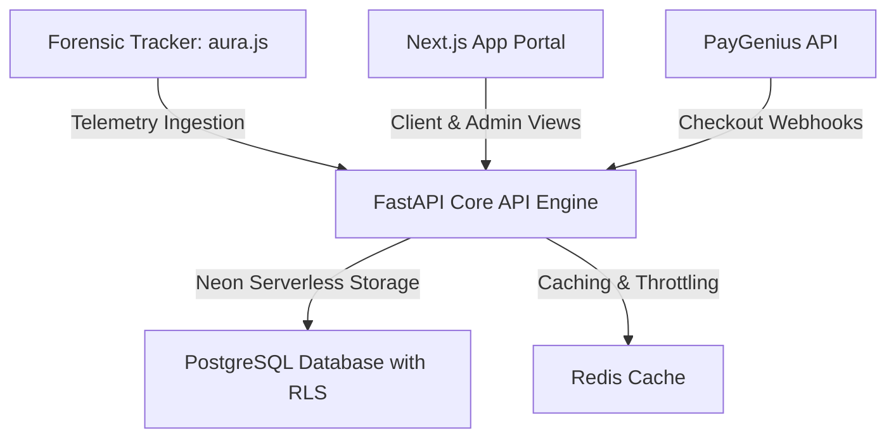

# 🏗️ Technical Specification: Industrial Intelligence Engine (v2.0)

> [!WARNING]
> **Proprietary Software Notice:** This repository is private. Unauthorized copying, distribution, or use of any file within this repository is strictly prohibited. All rights reserved.

**Project Goal:** To build a privacy-first, B2B intent tracking and sales intelligence system that deanonymizes SADC corporate website traffic and routes High-Intent leads to industrial clients.

**Core Stack:** Next.js 14+ App Router, FastAPI (Python 3.12), SQLModel, PostgreSQL (Neon Serverless + RLS), Redis, Cloudflare R2, PayGenius API, Resend.

---

## 1. System Architecture Overview

The system follows a high-performance **Decoupled Monolith** architecture:



### 1.1 The Three Pillars
1. **The Edge (Forensic Tracker):** A lightweight (`<1KB`) script hosted via Cloudflare R2 with optimized caching (`max-age=86400`). Features an offline cache (`AuraOfflineQueue`) built on IndexedDB to handle network dropouts in SADC mining/manufacturing districts.
2. **The Core (FastAPI Engine):** An async Python server handling high-volume ingestion, enrichment, RLS authentication context, billing hook validation, and reporting tasks.
3. **The Interface (Web Portal):** An App Router Next.js dashboard containing client analytics, onboarding funnels, and internal administrative controls.

---

## 2. Legal Topography (Two-Tier POPIA Identity Model)

To guarantee compliance with the South African Protection of Personal Information Act (POPIA), data subjects are processed across two strict logical boundaries:

| Feature / Metric | Tier 1: The Juristic Layer | Tier 2: The Personal Layer |
| --- | --- | --- |
| **Data Subject Class** | Juristic Persons (Companies, Mines, Corporations) | Natural Persons (Individual human visitors) |
| **Core Elements** | Company Name, Domain, Industry, City/Region, ASNs | First/Last Name, Personal Email, Direct Phone, Clear Fingerprints |
| **POPIA Status** | Legitimate Business Interest (No upfront consent required) | Explicit Opt-In Gated (Consent mandatory) |
| **Retention Window** | Permanent, immutable ledger tracking | 48-Hour conditional window (Scrubbed if unverified) |
| **Janitor Execution** | Protected from scrubbing cascades | Automatically anonymized/zeroed out if unverified |
| **Enrichment Triggers** | Immediate asynchronous IPinfo + Apollo extraction | Gated until prospect form submission or manual banner opt-in |

---

## 3. Persistent Database Schema (SQLModel Models)

The following database models specify the schema layout implemented via SQLModel abstractions:

### 3.1 Client & Subscription Management
```python
from enum import Enum
from typing import Optional, List
from datetime import datetime, timezone
from uuid import UUID, uuid4
from sqlmodel import SQLModel, Field, Relationship

class ClientCategory(str, Enum):
    INDUSTRIAL = "industrial"
    COMMERCIAL = "commercial"

class SubscriptionStatus(str, Enum):
    ACTIVE = "active"
    PAST_DUE = "past_due"
    SUSPENDED = "suspended"

class Client(SQLModel, table=True):
    __tablename__ = "client"
    
    id: UUID = Field(default_factory=uuid4, primary_key=True, index=True)
    company_name: str = Field(index=True)
    domain: str = Field(unique=True, index=True)
    category: ClientCategory = Field(default=ClientCategory.COMMERCIAL)
    client_product_description: str = Field(default="")
    subscription_status: SubscriptionStatus = Field(default=SubscriptionStatus.SUSPENDED)
    payment_plan: str = Field(default="monthly")
    setup_fee_paid: bool = Field(default=False)
    contract_signed_at: Optional[datetime] = Field(default=None, nullable=True)
    payment_provider_id: Optional[str] = Field(default=None, nullable=True)
    is_active: bool = Field(default=False)
    created_at: datetime = Field(default_factory=lambda: datetime.now(timezone.utc))
    auto_classified_at: Optional[datetime] = Field(default=None, nullable=True)
```

### 3.2 Enterprise Directory Core
```python
class Company(SQLModel, table=True):
    __tablename__ = "company"
    
    id: UUID = Field(default_factory=uuid4, primary_key=True, index=True)
    domain: str = Field(index=True)
    company_name: str = Field(index=True)
    industry: Optional[str] = Field(default=None, index=True)
    parent_company_id: Optional[UUID] = Field(default=None, foreign_key="company.id", nullable=True)
    is_headquarters: bool = Field(default=False)
    intent_summary: Optional[str] = Field(default=None, nullable=True)
    last_enrichment_attempt: Optional[datetime] = Field(default=None, nullable=True)
    cipc_verified: bool = Field(default=False)
    cipc_registration_number: Optional[str] = Field(default=None, nullable=True)
    created_at: datetime = Field(default_factory=lambda: datetime.now(timezone.utc))

class Department(SQLModel, table=True):
    __tablename__ = "department"
    
    id: UUID = Field(default_factory=uuid4, primary_key=True, index=True)
    company_id: UUID = Field(foreign_key="company.id", index=True)
    contact_name: str
    role_title: str = Field(index=True)
    email: str
    phone: Optional[str] = Field(default=None)
    linkedin_url: Optional[str] = Field(default=None)
    priority_score: int = Field(default=1, ge=1, le=5, index=True)
    created_at: datetime = Field(default_factory=lambda: datetime.now(timezone.utc))
```

### 3.3 Multi-Tenant Interaction Telemetry (RLS Gated)
```python
class VerificationStatus(str, Enum):
    VERIFYING = "verifying"
    VERIFIED = "verified"
    ANONYMIZED_CORPORATE = "anonymized_corporate"

class Visit(SQLModel, table=True):
    __tablename__ = "visit"
    
    id: UUID = Field(default_factory=uuid4, primary_key=True, index=True)
    client_id: UUID = Field(index=True)
    company_id: Optional[UUID] = Field(default=None, foreign_key="company.id", index=True, nullable=True)
    aura_id: str = Field(index=True)
    ip_address: str = Field(index=True)
    connection_type: str = Field(default="corporate")
    is_b2b: bool = Field(default=True, index=True)
    high_intent: bool = Field(default=False, index=True)
    verification_status: VerificationStatus = Field(default=VerificationStatus.VERIFYING, index=True)
    is_consented: bool = Field(default=False, index=True)
    fingerprint_hash: Optional[str] = Field(default=None, index=True, nullable=True)
    duration: int = Field(default=0)
    created_at: datetime = Field(default_factory=lambda: datetime.now(timezone.utc))
    updated_at: datetime = Field(default_factory=lambda: datetime.now(timezone.utc))

class PageView(SQLModel, table=True):
    __tablename__ = "page_view"
    
    id: UUID = Field(default_factory=uuid4, primary_key=True, index=True)
    client_id: UUID = Field(index=True)
    visit_id: UUID = Field(foreign_key="visit.id", index=True)
    url_path: str = Field(index=True)
    referrer: Optional[str] = Field(default=None)
    duration: int = Field(default=0)
    created_at: datetime = Field(default_factory=lambda: datetime.now(timezone.utc))
```

---

## 4. Edge Telemetry Loop & Interactive Layout Phases

### 4.1 Script Delivery & Caching
* Compiles down to `<1KB` using the Terser package pipeline.
* Served from optimized CDN buckets with `Cache-Control` headers set to `public, max-age=86400`.
* Local caching via `AuraOfflineQueue` on **IndexedDB** keeps telemetry intact when cellular networks in industrial zones drop out, syncing back on connection recovery.

### 4.2 The 4 Interactive Capture Phases
* **Phase 01:** 2.5-second initial delay triggers a subtle bottom-right slide-in prompting enterprise email input.
* **Phase 02:** Crossing a **50% scrolling ceiling** on technical specification sheets transforms the banner into a multi-column role/phone acquisition slide.
* **Phase 03:** Upward mouse acceleration triggers **exit-intent pop-ups** offering specialized parameter calculations.
* **Phase 04:** Fetching high-value schematics, blueprints, or CAD models prompts a strict download gate, forcing corporate email validation before releasing assets.

---

## 5. API Contract & Core Logic

### 5.1 Public Ingestion Protocols
* `POST /v1/track/entry`
  * **Input:** `{client_id, url_path, referrer, screen_res}`
  * **Process:** Verifies active subscriber status, maps network topologies, queries IPinfo asynchronously for new IPs, and creates `Visit` session entries.
* `POST /v1/track/exit`
  * **Input:** `{aura_id, duration, client_id, has_downloaded_asset}`
  * **Process:** Updates `PageView` dwell timings. Integrates the unconsented juristic loop (`track.py`) to bypass personal consent gates on purely company data:
  ```python
  lead = await get_lead_by_aura_id(payload.aura_id, session)
  company = await get_company_by_aura_id(payload.aura_id, session)
  
  if not lead and company:
      journey = await get_visitor_journey(payload.aura_id, session)
      if payload.total_duration >= 15 or payload.has_downloaded_asset:
          await handle_juristic_only_alert(company, journey, payload.client_id)
      return {"status": "processed_juristic"}
  ```

### 5.2 Janitor Selective Anonymization Cascade (`janitor.py`)
To comply with POPIA's natural person constraints, unconsented Tier 2 metrics are purged while Tier 1 B2B aggregates are permanently kept:
```python
async def execute_janitor_scrub_cascade(session: AsyncSession):
    time_threshold = datetime.now(timezone.utc) - timedelta(hours=48)
    stmt = (
        update(Visit)
        .where(Visit.is_consented == False)
        .where(Visit.verification_status == VerificationStatus.VERIFYING)
        .where(Visit.created_at < time_threshold)
        .values(
            email=None,
            visitor_name=None,
            fingerprint_hash=None,
            verification_status=VerificationStatus.ANONYMIZED_CORPORATE,
            updated_at=datetime.now(timezone.utc)
        )
    )
    await session.execute(stmt)
    await session.commit()
```

---

## 6. Financial Onboarding & Tenant Isolation

### 6.1 Onboarding Pipeline
1. Client checkout is processed via **PayGenius API** integration.
2. Webhooks received at `/api/v1/webhook/paygenius` launch background tasks.
3. Compiles a customized formal Service Agreement PDF using `reportlab`, cryptographically signs it, and sends it via **Resend** alongside onboarding setup scripts.

### 6.2 Database Tenant Isolation (RLS)
PostgreSQL enforces strict Row-Level Security rules to isolate interaction data between tenants:
```sql
ALTER TABLE visit ENABLE ROW LEVEL SECURITY;

CREATE POLICY tenant_isolation_policy ON visit
FOR ALL
USING (client_id = current_setting('app.current_client_id', True)::uuid);
```

---

## 7. Hosting & Deployment Topology

* **FastAPI Core Service:** Run in Docker (`python:3.12-slim`) deployed to a **Railway Starter Plane** instance to circumvent scale-to-zero telemetry cold starts.
* **Database Cluster:** Deployed on **Neon Serverless PostgreSQL** infrastructure.
* **Notifications:** Slack real-time alerts fire on High-Intent milestones, gated by an hourly throttle (`NotificationThrottle` model) permitting a maximum of 1 notification per hour per company entity.
