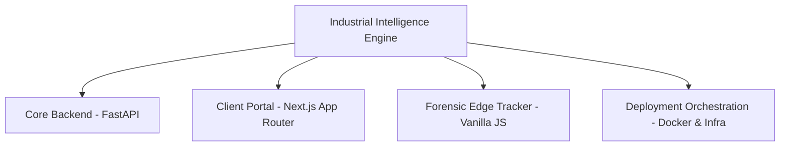

# 📂 Project Directory Structure & Blueprint (v2.0)

> [!WARNING]
> **Proprietary Software Notice:** This repository is private. Unauthorized copying, distribution, or use of any file within this repository is strictly prohibited. All rights reserved.

The **Industrial Intelligence Engine** is organized as a Decoupled Monorepo, segregating the client-side tracking script, the core business API server, administrative interfaces, and orchestration playbooks.



---

## 🏛️ 1. Core API Engine (`/backend`)

The backend is built on **FastAPI** (Python 3.12) and **SQLModel** (Pydantic + SQLAlchemy) to handle high-throughput, async ingestion and enrichment queues.

* **`app/`**: Core application runtime directory.
  * **`api/v1/`**: Route handlers.
    * `track.py`: Ingestion controller (`/entry`, `/exit`). Fully bypasses exit consent gates for juristic company identities, allowing analytics data to aggregate.
    * `clients.py`: Client account configurations and tenant management.
    * `leads.py`: Lead analytics dashboard aggregation.
    * `webhook.py`: Validates **PayGenius API** hooks, triggers cryptographically signed PDF Service Agreements using `reportlab`, and emails them via Resend.
  * **`core/`**: Central systems configuration.
    * `config.py`: Environment parameters (Database connections, IPinfo secrets, PayGenius tokens).
    * `security.py`: JWT generation, cryptographic signatures, and **AES-256 field-level encryption** utilities (visitor email, phone, location GPS).
  * **`models/`**: SQLModel schemas mapping to PostgreSQL:
    * `client.py`: Tenant classifications (Industrial vs. Commercial) and billing profiles.
    * `company.py`: SADC Firmographic directory database (CIPC metadata, domains, and aggregate intents).
    * `department.py`: Corporate contacts and role priorities.
    * `visit.py`: Multi-tenant session telemetry containing unmasked network markers.
    * `pageview.py`: Granular route hits and tracking active dwell times.
  * **`services/`**: Core business services.
    * `enrichment.py`: Async IPinfo lookup integrations, Apollo API resolvers, and cellular/residential ISP blacklist ranges (MTN, Vodacom, Telkom, Rain, Afrihost).
    * `reports.py`: Custom PDF report compiler (`reportlab`) generating weekly statistics.
    * `janitor.py`: Purge scheduler implementing the **POPIA Anonymization Cascade**, zeroing out unconsented natural person fields after 48 hours.
  * `db.py`: Neon serverless PostgreSQL engine configurations. Implements the engine-level **Row-Level Security (RLS)** policy wrapper.
  * `main.py`: FastAPI entry point.
* **`async_migrations/`**: Alembic migration scripts.
* `pyproject.toml`: Modern dependency declaration managed via `uv`.

---

## 🎨 2. Analytics Portal (`/frontend`)

The administrative and client-facing web application, built with **Next.js 14+** (App Router) and **TypeScript**.

* **`src/app/`**: Application routing paths.
  * (authenticated)/aurahq/: Unified layout and navigation frame (AuraHQ).
    * admin/: Internal administration portal to coordinate 200 client instances and audit aggregate traffic logs.
    * dashboard/: B2B client dashboard displaying unmasked visit feeds and script installations.
  * login/: Next.js login page containing the Google OAuth authentication trigger.
    * callback/: Handles Google redirect, exchanging state with FastAPI backend.
  * apply/: Multi-stage qualifying form (A/B testing) designed to filter inbound sales prospects based on company scale.

* **`components/`**: Muted-theme, high-end visual dashboard components leveraging Tailwind CSS and **Shadcn/UI**.
* **`hooks/`**: Custom React context hooks managing session logic and data revalidation queries (SWR).
* **`lib/`**: Validator modules (Zod schemas), API clients, and text-parsing utils.

---

## 🛰️ 3. Forensic Edge Script (`/tracker`)

The high-performance, non-blocking client-side script deployed on client websites.

* **`src/`**: Human-readable tracking logic.
  * `index.js`: Captures GPU clocks, screen resolutions, and history routing. Integrates `AuraOfflineQueue` on **IndexedDB** for local telemetry caching when connectivity drops.
* **`dist/`**: Compressed deployment files.
  * `tracker.min.js`: Terser-minified production payload (`<1KB` gzipped) optimized for Cloudflare CDN distribution.
* `package.json`: Compression scripts utilizing Terser.

---

## 🛠️ 4. Local & Production Infrastructure (`/infra`)

Orchestration, environment variables, and Docker configurations.

* **`docker-compose.yml`**: Root orchestration services (FastAPI web app, PostgreSQL DB with RLS enabled, Redis caching instance).
* **`Dockerfile`**: Compiles production containers using `ghcr.io/astral-sh/uv:python3.12-alpine` layers.
* **Railway Starter configurations**: Setup parameters preventing cold-start scaling on Railway starter planes.
* **Neon PostgreSQL configurations**: Target database clusters.

---

## 📁 Repository Map

```industrial-intelligence/
├── backend/                # FastAPI Application Core
│   ├── app/
│   │   ├── api/            # API Route endpoints
│   │   │   └── v1/
│   │   │       ├── track.py      # Entry & Exit telemetries
│   │   │       ├── clients.py    # Client account manager
│   │   │       ├── leads.py      # Analytics table aggregate
│   │   │       ├── webhook.py    # Webhooks & security signatures
│   │   │       └── billing.py    # Billing checkout setup & history
│   │   ├── core/           # Security, encryption & config
│   │   ├── models/         # SQLModel database schemas (Client, Transaction, Visit...)
│   │   ├── services/       # Enrichment, payment clients, PDFs & Janitors
│   │   ├── db.py           # Postgres Engine & RLS Policies
│   │   └── main.py         # FastAPI Entry point
│   ├── async_migrations/   # Alembic Database Migrations
│   ├── pyproject.toml      # Dependency definitions
│   └── requirements.txt    # Frozen dependency lists
│
├── frontend/               # Next.js Application
│   ├── src/
│   │   ├── app/            # Next.js App Router Pages
│   │   │   ├── (authenticated)/
│   │   │   │   └── aurahq/ # Unified dashboard command center (AuraHQ)
│   │   │   │       ├── admin/      # Admin Control Panels
│   │   │   │       └── dashboard/  # Client Analytics Portals
│   │   │   ├── login/      # Google OAuth login gate
│   │   │   │   └── callback/ # OAuth callback processor
│   │   │   └── apply/      # Qualifying Funnel Forms

│   │   ├── components/     # Shadcn/UI Elements
│   │   ├── hooks/          # React hooks & SWR fetches
│   │   └── lib/            # Zod validation & API utility proxies
│   └── package.json
│
├── tracker/                # Forensic Edge Tracker
│   ├── src/
│   │   └── index.js        # ES6 tracker logic (IndexedDB queue)
│   ├── dist/
│   │   └── tracker.min.js  # Compiled & Terser-minified script
│   └── package.json        # Build parameters (Terser compilation)
│
├── infra/                  # Deployments, Docker & Playbooks
│   └── README.md
│
├── docs/                   # Specification & Architectural reference documentation
│   ├── master_architecture_spec.md
│   ├── REMEMBER.md
│   ├── VOID_CONTEXT.md
│   ├── spec-sheet.md
│   └── structure.md
│
├── docker-compose.yml      # Multi-container local orchestration
└── .env                    # Root environment variables (Never committed to Git)
```

---

## ⚖️ License

**Copyright (c) 2026 AuraWorks Pty (ltd). All Rights Reserved.**
Unauthorized copying, modification, or redistribution of this software is strictly prohibited.
