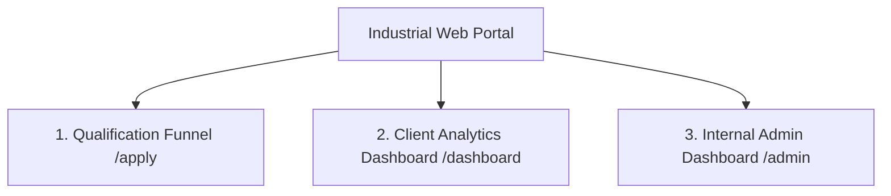

# 🎨 Industrial Intelligence Web Portal (Frontend)

> [!WARNING]
> **Proprietary Software Notice:** This repository is private. Unauthorized copying, distribution, or use of any file within this repository is strictly prohibited. All rights reserved.

The **Industrial Intelligence Web Portal** is a Next.js-powered application designed to deliver real-time traffic deanonymization analytics and lead routing interfaces. 

---

## 🏛️ Portal Architecture & Personas

The frontend serves three critical business functions, encapsulated within a secure Next.js App Router workspace:



### 1. The High-Friction Qualification Funnel (`/apply`)
A multi-stage, behaviorally-gated form sequence. Designed to filter out unqualified prospects using conditional validation logic (e.g., qualifying companies based on monthly site traffic and revenue size targets before onboarding).

### 2. The Client Analytics Portal (`/dashboard`)
A beautiful, highly interactive dashboard that allows B2B clients to view:
* **The Live Feed:** Real-time unmasked company visits, with logs containing duration and paths visited.
* **Firmographic Insights:** Breakdown of company size, industry classification, and geolocation details.
* **Integration Center:** Configuration panel to download custom `aura.js` tracking tags.

### 3. The Internal Admin Control Panel (`/admin`)
An enterprise control dashboard where **AuraWorks** admins can:
* Manage the 200 high-value industrial client accounts.
* Monitor aggregate platform statistics (total tracked pageviews vs. resolved B2B identities).
* Generate, review, and manually trigger weekly PDF reports.

---

## 💎 Design System & Aesthetic ("Quiet Premium")

Following strict AuraWorks design guidelines, the user interface adheres to a **"Quiet Premium"** visual philosophy:
* **Color Palette:** Muted slates, rich deep greys, subtle obsidian backdrops, and high-contrast silver typography. No screaming neon accents.
* **Layout:** Generous whitespace, clean card outlines, responsive grids, and crisp text hierarchies utilizing clean fonts.
* **Component Library:** Standardized using **Shadcn/UI** widgets styled with Tailwind CSS, ensuring smooth animations and modern visual states.

---

## 📂 Project Structure

```text
frontend/
├── src/                    # Next.js Application Core
│   ├── app/                # App Router Routes & Pages
│   │   ├── (auth)/         # Magic link login & Secure session onboarding
│   │   ├── admin/          # Admin Control Panel (Internal management)
│   │   ├── dashboard/      # Client-facing B2B analytics portal
│   │   └── apply/          # High-friction qualification funnel forms (A/B testing)
│   ├── components/         # Premium UI Components (Shadcn/UI + custom charts)
│   ├── hooks/              # Custom React hooks (analytics fetching, session caching)
│   ├── lib/                # API clients, validators (Zod), and utility functions
│   └── public/             # Optimized image assets and structural SVGs
└── README.md               # High-level system overview (This document)
```

---

## ⚙️ Development Instructions

To set up, configure, and launch the Next.js portal, refer to the detailed **[Developer Guide](src/README.md)** located in the `src` directory.

---

## ⚖️ License

**Copyright (c) 2026 AuraWorks Pty (ltd). All Rights Reserved.**
Unauthorized copying, modification, or redistribution of this software is strictly prohibited. Use is granted solely to active subscribers of the Industrial Intelligence Engine.
