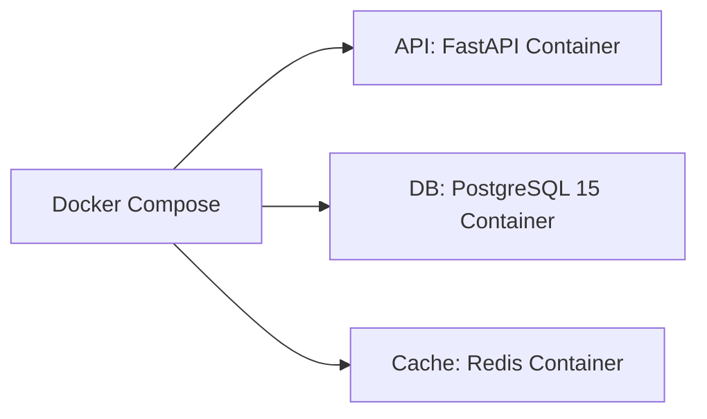

# 🛠️ Infrastructure & Deployment Orchestration

> [!WARNING]
> **Proprietary Software Notice:** This repository is private. Unauthorized copying, distribution, or use of any file within this repository is strictly prohibited. All rights reserved.

This directory manages the provisioning, containerization, and deployment orchestration for the **Industrial Intelligence Engine**. It guarantees identical runtime environments across **Local Development**, **Staging**, and **Production**.

---

## 📦 Containerization Architecture

We leverage **Docker** containers to pack the core API and the database environment. This eliminates environment drift between developer machines and cloud providers.



### 1. The FastAPI Web Application (`Dockerfile`)
* **Base Platform:** `ghcr.io/astral-sh/uv:python3.12-alpine`
* **Dependency Resolver:** `uv sync --frozen` for rapid package instantiation.
* **Process Manager:** Uvicorn running standard multi-worker routines.

### 2. The PostgreSQL Storage Engine
* **Base Image:** `postgres:15-alpine`
* **Persistence:** Named volumes map to WSL 2 filesystems, preserving database records between restarts.

---

## 🏗️ Local Orchestration (Docker Compose)

The primary `docker-compose.yml` resides in the root directory and configures the following networks and ports:

| Service | Container Port | Host Port | Purpose |
| --- | --- | --- | --- |
| **api** | `8080` | `8000` | FastAPI Backend Services (Uvicorn Dev Process) |
| **db** | `5432` | `5432` | PostgreSQL Vault Engine |
| **redis** | `6379` | `6379` | Cache system for IPinfo queries and rate-limiting |

---

## ⚡ CLI Reference (Local Development)

Execute the following commands from the project workspace root:

### 1. Spin Up Local Services
Launches the PostgreSQL database and Redis services in detached mode:
```bash
docker compose up -d
```

### 2. Review Inbound Stream Logs
Tail the logs from all services to audit database connections or API requests:
```bash
docker compose logs -f
```

### 3. Graceful Stop
Halts the services without modifying the database volumes or cached sessions:
```bash
docker compose stop
```

### 4. Full Teardown & Reset
Stops the containers and purges all local PostgreSQL records:
```bash
docker compose down -v
```

---

## 🚀 Production Deployments

### 1. Web Service Deployment (Render.com)

Render integrates with the GitHub repository, building the FastAPI Docker image automatically.

#### Build Command
```bash
pip install uv && uv sync --frozen
```

#### Start Command
```bash
uv run uvicorn app.main:app --host 0.0.0.0 --port $PORT
```

#### Environment Configurations
Add these keys under the Service Environment Panel:
* `DATABASE_URL`: Production PostgreSQL connection string (e.g., Neon.tech serverless URL).
* `ENVIRONMENT`: `production`
* `PYTHON_VERSION`: `3.12`
* `CORS_ORIGINS`: `["https://yourclientportal.com"]`

> [!NOTE]
> Under Render's free tier, containers scale down to zero after 15 minutes of inactivity. For low-latency tracking, it is recommended to upgrade to a **Starter** instance to ensure the API stays "always-on" and doesn't drop client tracking events.

---

## 🔒 Secret Keys & Environment Injection

Under no circumstances should API keys, database credentials, or secret variables be committed to Git.
* A `.env` file must be generated locally based on the `.env.example` blueprint.
* Production secrets must be injected securely via the cloud platform dashboard console.

---

## 🛠️ Database Administration & Shells

To access the PostgreSQL console directly within the running container for troubleshooting queries:

```bash
docker exec -it industrial_db_container psql -U postgres -d industrial_db
```

---

## ⚖️ License

**Copyright (c) 2026 AuraWorks Pty (ltd). All Rights Reserved.**
Unauthorized copying, modification, or redistribution of this software is strictly prohibited.
