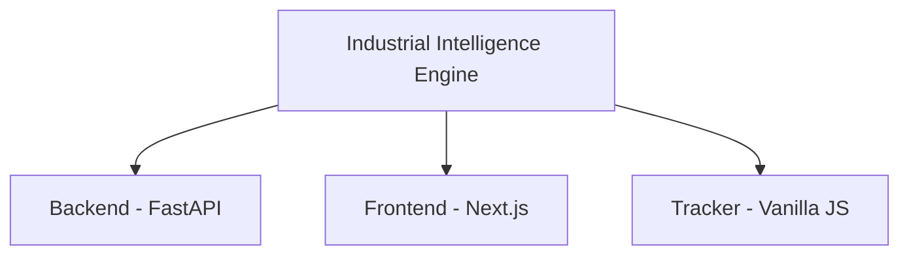

## 📂 Project Directory Structure

### 🏗️ 1. Backend (`/backend`)

The core intelligence hub, built with **FastAPI** and **SQLModel**.

* **`app/`**: Main application logic.
* **`api/v1/`**: API Route handlers.
* `track.py`: Primary ingestion point for visitor pings.
* `clients.py`: Internal management for R10k/month customers.
* `leads.py`: Data aggregation for dashboard views.

* **`core/`**: System-wide settings.
* `config.py`: Environment variable management (`DATABASE_URL`, `IPINFO_TOKEN`).
* `security.py`: Logic for JWT auth and encryption.

* **`models/`**: Database schemas (SQLModel).
* `client.py`: Customer account data.
* `visit.py`: Initial session data (IP, Company Name, B2B status).
* `pageview.py`: Granular tracking (URL paths, duration).

* **`services/`**: The "Engine Room."
* `enrichment.py`: IPinfo API integration and ISP filtering logic.
* `reports.py`: Weekly PDF generation and email automation.

* `db.py`: Database session and engine configuration.
* `main.py`: FastAPI application entry point.

* **`tests/`**: Pytest suite for API reliability.
* **`requirements.txt`**: Python dependencies.

---

### 🎨 2. Frontend (`/frontend`)

The user interface, built with **Next.js 14** (App Router).

* **`src/app/`**: Main routing and pages.
* `(auth)/`: Logic for secure login and onboarding.
* `admin/`: Your internal control panel to manage all 200 clients.
* `dashboard/`: The client-facing analytics portal.
* `apply/`: The high-friction qualification funnel (Form A/B).

* **`components/`**: UI components using **Shadcn/UI** and Tailwind CSS.
* **`hooks/`**: Custom React hooks for data fetching and session management.
* **`lib/`**: Shared utility functions and API client definitions.
* **`package.json`**: Node.js dependencies and scripts.

---

### 🛰️ 3. Tracker (`/tracker`)

The edge layer script provided to your clients.

* **`src/index.js`**: The source logic for capturing visitor fingerprints.
* **`package.json`**: Build scripts to minify the script into `tracker.min.js`.

---

### 🛠️ 4. Root Files

* **`docker-compose.yml`**: Orchestration for local development (FastAPI + Postgres).
* **`.env`**: Global environment secrets (Not committed to Git).

---

industrial-intelligence/
├── backend/                # FastAPI Application
│   ├── app/
│   │   ├── api/            # Route handlers
│   │   │   ├── v1/
│   │   │   │   ├── track.py      # Receives pings from Tracker.js
│   │   │   │   ├── clients.py    # Admin routes for managing clients
│   │   │   │   └── leads.py      # Fetching lead data for dashboards
│   │   ├── core/           # Configuration & Security
│   │   │   ├── config.py         # Env vars & API keys
│   │   │   └── security.py       # Encryption logic for IPinfo keys
│   │   ├── models/         # SQLModel Database Schemas
│   │   │   ├── client.py         # Client Profile schema
│   │   │   ├── visit.py          # Visit/Session schema
│   │   │   └── pageview.py       # Duration/Path schema
│   │   ├── services/       # Business Logic (The "Blue Box")
│   │   │   ├── enrichment.py     # IPinfo API integration
│   │   │   └── reports.py        # PDF Generation logic (Generator.py)
│   │   ├── db.py           # Neon Postgres connection
│   │   └── main.py         # FastAPI Entry point
│   ├── tests/              # Pytest suite
│   └── requirements.txt
│
├── frontend/               # Next.js Application
│   ├── src/
│   │   ├── app/            # App Router (Pages)
│   │   │   ├── (auth)/     # Login/Signup pages
│   │   │   ├── admin/      # Your Internal Dashboard
│   │   │   ├── dashboard/  # Client-facing Dashboard (Magic link access)
│   │   │   └── apply/      # Form A & Form B (The Lead Funnel)
│   │   ├── components/     # UI Library (Shadcn/UI)
│   │   ├── hooks/          # Custom React hooks
│   │   └── lib/            # API fetching & Utils
│   └── package.json
│
├── tracker/                # The Client-Side Script
│   ├── src/
│   │   └── index.js        # Minified Tracker.js (Served via CDN/S3)
│   └── package.json
│
├── docker-compose.yml      # For local development
└── .env                    # Root environment variables